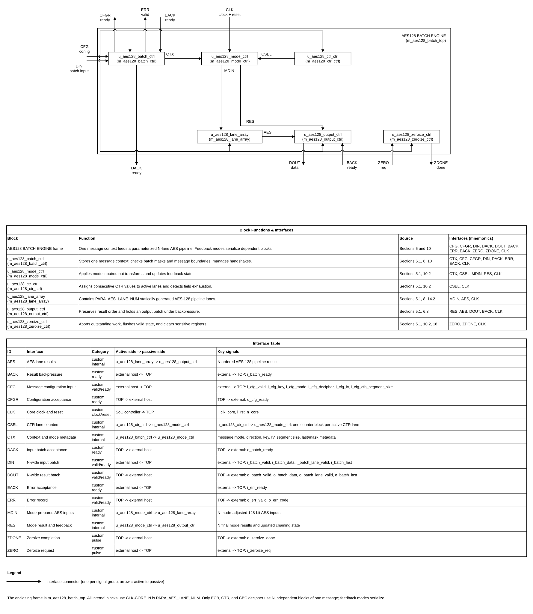

# AES-128 High-Throughput Batch Engine Design Specification

Project: AES-128 ECB/CBC/CFB/OFB/CTR  
Author: Nguyen Hung Quan (user)  
AI flow: VLSIT ASIC IP MicroSpec  
Date: 2026-10-28

> **Purpose:** Target contract for a pipelined AES-128 IP with one message context and parameterized N-block batches. Open decisions and unmeasured PPA targets are in Section 20.
>
> **shall** is mandatory and testable; **should** is recommended; **may** is optional. Each mandatory requirement has a stable ID and verification method.

## Document map

1. [Purpose, scope, and product context](#1-purpose-scope-and-product-context)
2. [Normative references and precedence](#2-normative-references-and-precedence)
3. [Requirements and traceability](#3-requirements-and-traceability)
4. [Features and configurations](#4-features-and-configurations)
5. [Architecture](#5-architecture)
6. [External interfaces and ports](#6-external-interfaces-and-ports)
7. [Clock, reset, and power](#7-clock-reset-and-power)
8. [Parameters and elaboration configurations](#8-parameters-and-elaboration-configurations)
9. [Data representation and arithmetic](#9-data-representation-and-arithmetic)
10. [Detailed functional behavior](#10-detailed-functional-behavior)
11. [Register and programming model](#11-register-and-programming-model)
12. [Error handling and recovery](#12-error-handling-and-recovery)
13. [Performance, power, and area](#13-performance-power-and-area)
14. [RTL implementation contract](#14-rtl-implementation-contract)
15. [Verification specification](#15-verification-specification)
16. [DFT and testability](#16-dft-and-testability)
17. [Physical design and timing integration](#17-physical-design-and-timing-integration)
18. [Security, safety, and reliability](#18-security-safety-and-reliability)
19. [Requirement-to-verification traceability](#19-requirement-to-verification-traceability)
20. [Assumptions, dependencies, and decisions](#20-assumptions-dependencies-and-decisions)
21. [Glossary](#21-glossary)
22. [References used to shape this template](#22-references-used-to-shape-this-template)

## 1. Purpose, scope, and product context

### 1.1 Purpose and scope

The IP accepts one AES-128 message context, then processes batches of up to N ordered 128-bit blocks through N pipelined AES lanes. N is selected at elaboration by PARA_AES_LANE_NUM. The host configures key and mode once, then transfers batches using synchronous valid/ready handshakes.

**Included:** AES-128 encryption/decryption; ECB, CBC, CFB, OFB, CTR; CFB segment sizes 1, 2, 4, 8, 16, 32, 64, 128 bits; parameterized 1-to-4-lane pipeline; N-wide batches; configurable CTR field width; backpressure; error reporting; zeroization.

**Excluded:** AES-192/256, padding, partial 128-bit blocks for ECB/CBC/OFB/CTR, GCM/authentication tags, key generation/provisioning, IV/nonce generation, software-visible CSRs, and claims of side-channel or fault-injection resistance. GCM is outside v0.1 unless later approved.
These modes provide confidentiality transforms only. They do not authenticate ciphertext or associated data. The system integrator owns authentication, key lifecycle, IV policy, and CTR initial-value uniqueness.

### 1.2 Deployment assumptions

| Item | Specification |
|---|---|
| Target SoC / product class | ASIC accelerator or FPGA prototype; exact SoC TBD |
| Technology / library assumptions | No library supplied; PPA not measured |
| Operating modes and workload | One configured message at a time; N-wide batches |
| Security / privilege context | Direct key input; no CSR or key-manager sideload |
| External dependencies | Host supplies key, IV/counter initial value, traffic, and mode-appropriate uniqueness |

### 1.3 Feature summary

| Feature ID | Feature | Required / optional | Configuration condition | Requirements |
|---|---|---|---|---|
| FEAT-001 | AES-128 encrypt/decrypt | Required | All builds | REQ-FUNC-001 |
| FEAT-002 | ECB/CBC/CFB/OFB/CTR | Required | Selected per message | REQ-FUNC-002 |
| FEAT-003 | Pipelined N-lane batch datapath | Required | PARA_AES_LANE_NUM=1..4 | REQ-PERF-001 |
| FEAT-004 | CTR low-field counter | Required | PARA_CTR_WIDTH=1..128 | REQ-FUNC-006 |
| FEAT-005 | Valid/ready interface | Required | All builds | REQ-IF-001 |
| FEAT-006 | Zeroization | Required | Request or reset | REQ-SEC-001 |
| FEAT-007 | GCM/authentication | Excluded by user decision | Not present | DEC-SEC-001 |

## 2. Normative references and precedence

### 2.1 Normative references

| Ref ID | Document and revision | Applicable clauses | Authority / notes |
|---|---|---|---|
| REF-001 | NIST FIPS 197-upd1, AES, May 2023 | §§4–6; Appendix C.1 | AES-128 primitive/KAT. Local conversion: [../shared/references/md_doc/nist_fips_197_upd1.md](../shared/references/md_doc/nist_fips_197_upd1.md). Official source: https://csrc.nist.gov/pubs/fips/197/final |
| REF-002 | NIST SP 800-38A, December 2001 | §§5–7; §8; Appendix B.1 | Modes and IV/counter requirements. Local conversion: [../shared/references/md_doc/nist_sp_800_38a.md](../shared/references/md_doc/nist_sp_800_38a.md). Official source: https://csrc.nist.gov/pubs/sp/800/38/a/final. NIST's page notes a planned revision; this specification is anchored to the published 2001 final until a replacement is issued and reviewed. |
| REF-003 | VLSIT RTL Design Rules v2 | All applicable rules | ../../../VLSIT_RTL_Generator_AI_Model/spec_template/VLSIT_RTL_Design_Rule.md |
| REF-004 | IEEE 1800-2017 SystemVerilog | Synthesizable subset | Subject to REF-003 and frontend support |
| REF-005 | Existing AES README and RTL | As-is baseline only | ../README.md and ../rtl |

The two cited NIST standards were downloaded from the official NIST pages and converted to project-local Markdown after user approval. The original PDFs, checksums, retrieval date, and conversion metadata are indexed in [../shared/references/md_doc/vlsit_INDEX.md](../shared/references/md_doc/vlsit_INDEX.md). The project-local copies do not modify the skill's bundled reference library.

### 2.2 Source-of-truth and conflict handling

1. REF-001 defines the AES-128 primitive.
2. REF-002 defines selected mode equations and IV/counter requirements.
3. User decisions define batch framing, parameters, handshake, error, reset, and zeroization.
4. This specification defines target behavior; current RTL is compatibility evidence only.
5. REF-003 is mandatory; no project-local RTL exception is allowed.
6. CTR does not imply GCM or authentication.
7. Missing decisions remain TBD in Section 20.

**Naming rule:** VLSIT default RTL Design Rule v2, Section 2; path ../../../VLSIT_RTL_Generator_AI_Model/spec_template/VLSIT_RTL_Design_Rule.md. The earlier proposal PARA_CTR_W is written PARA_CTR_WIDTH because “W” is not an approved abbreviation for “width.”

### 2.3 Compliance declaration

| Standard | Revision / profile | Role implemented | Options | Deviations |
|---|---|---|---|---|
| NIST FIPS 197 | FIPS 197-upd1, 2023 | AES-128 | 128-bit key/block | No AES-192/256 |
| NIST SP 800-38A | December 2001 | ECB/CBC/CFB/OFB/CTR | CFB segment subset | No authentication |
| Custom batch interface | Project-defined v0.1 | One message, N lanes | Synchronous valid/ready | Not AMBA/TileLink |

## 3. Requirements and traceability

| ID | Requirement using shall/should/may | Source | Applies to | Verification method |
|---|---|---|---|---|
| REQ-FUNC-001 | The IP shall implement AES-128 encrypt/decrypt on 128-bit blocks using a 128-bit key. | REF-001 §§4–6 | All | Independent KATs |
| REQ-FUNC-002 | The IP shall support ECB, CBC, CFB, OFB, and CTR selected once per message. | REF-002 §§5–7 | All | Mode reference tests |
| REQ-FUNC-003 | The IP shall preserve batch and lane order. | Product decision | All | Ordered scoreboard |
| REQ-FUNC-004 | Key, mode, direction, IV/counter, and CFB size shall remain fixed during a message. | Product decision; REF-002 | All | Assertions/negative tests |
| REQ-FUNC-005 | CFB size shall be 1,2,4,8,16,32,64,128 bits and fixed for a message. | REF-002 §6 | CFB | Test each size |
| REQ-FUNC-006 | CTR shall increment only the low PARA_CTR_WIDTH bits; upper bits remain fixed. | REF-002 App. B.1; user decision | CTR | Counter sequence tests |
| REQ-FUNC-007 | A CTR batch that would wrap shall be rejected atomically before AES processing. | User decision | CTR | Boundary/atomicity tests |
| REQ-FUNC-008 | On a valid configuration handshake, the IP shall derive and store all 11 AES-128 round keys K0–K10 on that edge. It shall not accept a data batch on the same edge; the earliest batch handshake is the next rising edge, with no additional key-schedule wait cycles. Decipher shall consume the round keys in reverse order, beginning with K10 and ending with K0. | DEC-AES-KEY-001; REF-001 §§5.2–5.3 | All | Config-to-data timing assertion; encrypt/decrypt KATs |
| REQ-FUNC-009 | The AES primitive shall use decipher direction only for ECB/CBC when `i_cfg_decipher=1`; it shall use encryption direction for CFB, OFB, and CTR for both data directions. | REF-001 §§5.1, 5.3; REF-002 §§6–7 | All modes | Mode-specific encrypt/decrypt KATs |
| REQ-IF-001 | The IP shall accept configuration only when i_cfg_valid and o_cfg_ready are both high at a rising edge. | Product decision | All | Interface assertions |
| REQ-IF-002 | The IP shall accept a batch only when i_batch_valid and o_batch_ready are both high at a rising edge. | Product decision | All | Interface assertions |
| REQ-IF-003 | The IP shall hold output payload stable during backpressure, except on reset or accepted zeroize abort. | Product decision | All | Stability assertions |
| REQ-IF-004 | The IP shall accept only nonzero contiguous lane prefixes beginning at lane 0. | Product decision | All | Mask tests |
| REQ-IF-005 | The IP shall propagate i_batch_last to o_batch_last for the corresponding result. | Product decision | All | Last-beat tests |
| REQ-CLK-001 | The IP shall sample functional ports synchronously to i_clk_core except reset assertion. | Product decision | All | CDC/RDC inspection |
| REQ-RESET-001 | `i_rst_n_core` shall assert asynchronously and be deasserted synchronously to `i_clk_core` by the SoC before it reaches the IP. | User decision / SoC integration contract | All | SoC contract review and reset/RDC checks |
| REQ-RESET-002 | Reset shall abort work, clear valid state, and prevent stale results. | Product decision | All | Reset-stage tests |
| REQ-PARAM-001 | PARA_AES_LANE_NUM shall be 1..4, default 4. | User decision | All | Elaborate all values |
| REQ-PARAM-002 | PARA_CTR_WIDTH shall be 1..128, default 32. | User decision | CTR | Boundary elaboration |
| REQ-ERR-001 | The IP shall report illegal mode, CFB size, or lane mask and shall start no AES work. | Product decision | All | Error injection |
| REQ-ERR-002 | The IP shall produce no partial result when rejecting a CTR wrap batch. | Product decision | CTR | Atomicity assertion |
| REQ-ERR-003 | The IP shall hold an error record stable until `o_err_valid` and `i_err_ready` handshake, except reset or accepted zeroize clears the record. | Product decision | All | Error-handshake stability assertion |
| REQ-SEC-001 | When `i_zeroize_req` is sampled high, the IP shall abort in-flight work, clear sensitive context, chaining, counter, data, and valid state, and discard any pending error record on that same rising edge. It shall assert `o_zeroize_done` for the one-cycle interval immediately after the edge and shall not generate a zeroize error code. | User decision, 2026-10-27 | All | Cycle-accurate zeroize test and state audit |
| REQ-SEC-002 | The IP shall not claim authentication, key provisioning, IV generation, or SCA resistance. | Scope boundary | All | Review |
| REQ-PERF-001 | Each lane shall accept one independent block/cycle after fill when no feedback dependency blocks input. | User target | ECB/CTR/CBC dec | Throughput test/STA |
| REQ-PERF-002 | The IP shall support up to N blocks/cycle for ECB, CTR, and CBC decipher, subject to backpressure. | User target | Those modes | N-lane regression |
| REQ-PERF-003 | CBC encrypt, CFB, and OFB shall not accept a dependent next block until the prior result is registered and feedback state is updated. With no stalls, the minimum interval is 11 cycles between input handshakes (C0 to C11). No combinational feedback bypass is used. | DEC-PERF-004; REF-002 | Feedback modes | Cycle-accurate assertion |
| REQ-VER-001 | Verification shall use an independent model, not generated RTL, for expected results. | Project policy | All | Testbench review |
| REQ-VER-002 | Verification shall cover N=1..4, CTR widths 1/32/127/128, all modes, CFB sizes, stalls, reset, zeroize, and boundaries. | Verification plan | All | Regression/coverage |

## 4. Features and configurations

| Configuration ID | Enabled features | Disabled features | Interfaces / widths | Intended use | Verification target |
|---|---|---|---|---|---|
| CFG-AES128-N | Five modes, N-lane pipeline, valid/ready, zeroize | AES-192/256, GCM, CSR | N × 128-bit data; N=1..4 | High-throughput batches | N=1,2,3,4 |
| CFG-AES128-CTR32 | CFG-AES128-N with 32-bit counter | Other widths in this instance | 128-bit initial value; low 32 bits increment | Default CTR | Counter boundary tests |

N is an elaboration setting, not a runtime control. Parameters change port widths, not port names. Default build uses four lanes.

## 5. Architecture

### 5.1 Overview and block responsibilities

The `m_aes128_batch_core` stores message context and K0–K10, validates input/configuration, performs mode and counter control, manages errors/zeroize, and postprocesses results. It instantiates the combinational key expander and the N-lane AES pipeline. This consolidates the batch, mode, CTR, output, and zeroize controllers in one functional module to avoid additional internal handshakes. The tradeoff is a larger core source file.

The key-expansion combinational block derives K0–K10 from the accepted 128-bit key; the core captures all 1408 round-key bits on the valid configuration handshake. The first data batch may be accepted on the next rising edge; there are no key-schedule wait cycles. The configuration path from `i_cfg_key` through key expansion to the context registers must be checked by STA. Each lane has one shared, direction-selectable AES pipeline. Its effective AES direction is derived from mode and `i_cfg_decipher`: ECB/CBC use the configured direction, while CFB/OFB/CTR always use AES encryption. This selection remains fixed for the message. Each lane first captures the accepted batch in an input register, then passes it through 10 registered round stages. A batch accepted at C0 is captured at C0; round stages register results at C1 through C10, so `L_PIPE=10`. For encryption, initial AddRoundKey K0 is folded into stage 1 before its register; stages 1–9 perform rounds 1–9 using K1–K9, and stage 10 performs round 10 using K10 without MixColumns. For decryption, stage 1 starts with K10 and the inverse round-9 operation; the key order proceeds in reverse through K0 in stage 10. The encryption and decryption transformations differ, so shared pipeline registers/control do not guarantee that all combinational logic is shared or that area is halved; direction-selection logic can lengthen a stage path. STA must check both the stage-1 and direction-selected round paths. The stage-10 register is also the one-batch output register; it holds the raw AES result and aligned sideband while stalled. The core postprocesses the registered values without adding an output FIFO.

| Module | Responsibility | Parent / instance | Clock/reset domain | State or storage |
|---|---|---|---|---|
| m_aes128_batch_top | Structural top; one core instance only | Top | CLK-CORE/RST-CORE | None |
| m_aes128_batch_core | Context, key storage, configuration/batch control, modes, counter, errors, zeroize, and result postprocessing | Top/u_aes128_batch_core | CLK-CORE/RST-CORE | Context, 11 round keys, counters, feedback, error, and pipeline control |
| m_aes128_key_expand | Combinational AES-128 key expansion K0–K10 | Core/u_aes128_key_expand | Combinational | None |
| m_aes128_lane_array | Batch-level ready/valid, N generated lane pipelines, aligned mask/last | Core/u_aes128_lane_array | CLK-CORE/RST-CORE | Lane stage registers and metadata |
| m_aes128_pipe_lane | One input capture register, then one shared 10-stage AES pipeline and sideband delay | Array/u_aes128_pipe_lane_0..N-1 | CLK-CORE/RST-CORE | Input capture plus ten round stages; stage 10 is output storage |
| m_aes128_aes_round | One combinational AES forward/inverse round | Pipe/u_aes128_aes_round_0..9 | Combinational | None |

The 10-round pipeline depth is fixed by DEC-PERF-003. Round-key precomputation/storage is fixed by DEC-AES-KEY-001. Each lane uses the shared direction-selectable pipeline with effective AES direction derived from mode and `i_cfg_decipher`, per DEC-AES-ARCH-001. It does not change the approved 10-cycle no-stall contract.

### 5.2 Block diagram

The figure separates functions for clarity; the approved RTL hierarchy implements the batch, mode, counter, output, and zeroize control inside `m_aes128_batch_core`.

*Figure 5-1. AES-128 one-message N-block batch architecture. Source: `figures/aes128_batch_architecture.drawio` (draw.io, VLSIT library, drawn by `vlsit_spec_diagram.py`). The frame is the top module, the blocks are its instances, each connector is one interface with its mnemonic, and the two tables under the diagram in the source file describe the blocks and the interfaces.*

### 5.3 Transaction and dataflow

1. Host configures key, mode, direction, initial IV/counter, and CFB size once.
2. On a valid i_cfg_valid/o_cfg_ready handshake, the context captures all 11 expanded round keys (K0–K10) and the remaining message configuration. The first data batch may be accepted at the next rising edge.
3. Host sends up to N ordered blocks per batch with a contiguous active-lane prefix.
4. Batch is captured on i_batch_valid/o_batch_ready handshake.
5. Mode logic prepares inputs; CTR assigns counters; AES lanes process valid blocks.
6. Mode logic forms final results; lane and batch order are preserved.
7. Output transfers on o_batch_valid/i_batch_ready and holds during stalls.
8. Context is released after final output handshake.
9. Accepted zeroize aborts work, flushes output/error valids, clears sensitive state, and pulses completion without generating an error record.

### 5.4 Invariants

- At most one message context is active.
- Configuration is fixed during a message.
- Lane 0 is the earliest block; order is preserved.
- Lane masks are nonzero contiguous prefixes.
- CTR wrap never causes partial batch processing.
- Backpressure cannot drop, duplicate, or reorder output.
- Reset/zeroize clears pipeline, output, and error valid state.
- N-lane throughput applies only where block dependencies permit it.

## 6. External interfaces and ports

### 6.1 Interface inventory

| Interface ID | Type and revision | Role | Direction at IP boundary | Clock domain | Required / optional | Configurations |
|---|---|---|---|---|---|---|
| IF-CFG | Custom valid/ready | Configure one message | Bidirectional | CLK-CORE | Required | All |
| IF-DATA | Custom N-wide valid/ready | Transfer batches | Bidirectional | CLK-CORE | Required | All |
| IF-ERR | Custom error ready/valid | Report errors | Bidirectional | CLK-CORE | Required | All |
| IF-ZERO | Zeroize request/completion | Clear state | Bidirectional | CLK-CORE | Required | All |

These interfaces are not AMBA or TileLink.

### 6.2 Complete port list

| Port | Direction | Width | Meaning (function) | Clock domain | Signal type | Reset / idle value | Timing / sampling | Configurations |
|---|---|---:|---|---|---|---|---|---|
| i_clk_core | Input | 1 | Core clock | CLK-CORE | Clock | Not applicable: clock is not resettable | Rising edge | All |
| i_rst_n_core | Input | 1 | Active-low reset | RST-CORE | Reset | 0 in reset | Async assert, sync release | All |
| i_cfg_valid | Input | 1 | Config valid | CLK-CORE | Level | 0 | Hold until ready | All |
| o_cfg_ready | Output | 1 | Accept config | CLK-CORE | Level | 0 in reset/active | Handshake | All |
| i_cfg_key | Input | 128 | AES key | CLK-CORE | Data (valid with i_cfg_valid) | 0 recommended | Config handshake | All |
| i_cfg_mode | Input | 3 | 0 ECB, 1 CBC, 2 CFB, 3 OFB, 4 CTR | CLK-CORE | Data (valid with i_cfg_valid) | 0 | Config handshake | All |
| i_cfg_decipher | Input | 1 | 0 encrypt, 1 decipher | CLK-CORE | Data (valid with i_cfg_valid) | 0 | Config handshake | All |
| i_cfg_iv | Input | 128 | IV or CTR initial value | CLK-CORE | Data (valid with i_cfg_valid) | 0 | Config handshake; ignored in ECB | All |
| i_cfg_cfb_segment_size | Input | 4 | CFB segment encoding | CLK-CORE | Data (valid with i_cfg_valid) | 0 | Config handshake | CFB |
| i_batch_valid | Input | 1 | Input batch valid | CLK-CORE | Level | 0 | Hold with payload until ready | All |
| o_batch_ready | Output | 1 | Accept batch | CLK-CORE | Level | 0 in reset/idle and through the configuration-acceptance edge; may assert after a valid context is captured | Handshake | All |
|i_batch_data | Input | 128 × PARA_AES_LANE_NUM | Packed blocks; lane 0 is [127:0] | CLK-CORE | Data (valid with i_batch_valid) | 0 | Input handshake | All |
| i_batch_lane_valid | Input | PARA_AES_LANE_NUM | Active lane prefix | CLK-CORE | Data (valid with i_batch_valid) | 0 | Input handshake | All |
| i_batch_last | Input | 1 | Final input batch | CLK-CORE | Data (valid with i_batch_valid) | 0 | Input handshake | All |
| o_batch_valid | Output | 1 | Result batch valid | CLK-CORE | Level | 0 in reset/idle | Hold until ready | All |
| i_batch_ready | Input | 1 | Host accepts result | CLK-CORE | Level | 0 | Handshake | All |
| o_batch_data | Output | 128 × PARA_AES_LANE_NUM | Ordered result blocks | CLK-CORE | Data (valid with o_batch_valid) | Invalid when valid=0 | Stable during stall | All |
| o_batch_lane_valid | Output | PARA_AES_LANE_NUM | Active result lanes | CLK-CORE | Data (valid with o_batch_valid) | 0 | Stable with result | All |
| o_batch_last | Output | 1 | Final result batch | CLK-CORE | Data (valid with o_batch_valid) | 0 | Stable with result | All |
| o_err_valid | Output | 1 | Error record valid | CLK-CORE | Level | 0 | Hold until ready; cleared by reset or accepted zeroize | All |
| i_err_ready | Input | 1 | Host accepts error | CLK-CORE | Level | 0 | Handshake | All |
| o_err_code | Output | 4 | Error code | CLK-CORE | Data (valid with o_err_valid) | 0 | Stable until handshake; invalidated by reset or accepted zeroize | All |
| i_zeroize_req | Input | 1 | Abort/clear request | CLK-CORE | Pulse (1 cycle) | 0 | Rising edge | All |
| o_zeroize_done | Output | 1 | Clear completion | CLK-CORE | Pulse (1 cycle) | 0 | Asserted for one cycle immediately after the rising edge that samples `i_zeroize_req` and clears state | All |

### 6.3 Protocol behavior

**Configuration:** Accept only when i_cfg_valid and o_cfg_ready are high on a rising edge. Host holds all fields stable until accepted. Illegal mode/CFB size is consumed and reported; no context is created. Context fields remain fixed until final output handshake, reset, or zeroize.

**Input batch:** Accept only on i_batch_valid/o_batch_ready. Host holds data, mask, and last stable while stalled. For N=4, legal masks are 0001, 0011, 0111, 1111; smaller N uses a nonzero prefix of that width. Final batch may contain fewer than N complete blocks. No byte-level partial block is supported. No batch follows i_batch_last.

**Mode lane rules:** ECB, CTR, and CBC decipher may use all lanes. CBC encrypt, CFB, and OFB use lane 0 only for one message because the next input depends on feedback. CFB lane 0 carries one left-justified s-bit segment; lower input bits are ignored and lower output bits are zero.

**Output:** Data, mask, and last remain stable while o_batch_valid=1 and i_batch_ready=0. Reset and accepted zeroize are abort exceptions.

**Error record:** `o_err_code` remains stable while `o_err_valid=1` and `i_err_ready=0`. Reset or accepted zeroize clears the pending error record. Zeroize does not create a new error record.

| Case | Legal behavior | Illegal / unsupported case | IP response | Requirement IDs |
|---|---|---|---|---|
| Mode | 0..4 | 5..7 | Error 1; no context | REQ-ERR-001 |
| CFB segment | Code 0..7 | Code 8..15 | Error 1 | REQ-FUNC-005 |
| Lane mask | Nonzero prefix | Zero or holes | Error 2; no work | REQ-IF-004 |
| CTR | All active counters fit | Any active lane wraps | Reject whole batch; error 3 | REQ-FUNC-007 |
| Reconfigure | After final result accepted | While context/result active | o_cfg_ready=0 | REQ-IF-001 |
| Partial block | CFB segment as encoded | Partial ECB/CBC/OFB/CTR | Host handles padding/framing | Scope |
| Zeroize | `i_zeroize_req` high at a rising edge | None | Abort and clear state/output/error valids on that edge; pulse `o_zeroize_done` for the following cycle; do not emit code 4 | REQ-SEC-001 |

### 6.4 Interrupts and events

No interrupt is defined. Errors and zeroize completion use the listed ports. A CSR/interrupt wrapper is outside this Draft.
## 7. Clock, reset, and power

### 7.1 Clock domains

| Domain | Clock port | Edge | Frequency range | Source | Relationship to other clocks | Gating policy |
|---|---|---|---|---|---|---|
| CLK-CORE | i_clk_core | Rising | TBD by SoC | SoC clock controller | Single synchronous domain | Approved ICG only |

### 7.2 CDC and RDC

No functional CDC is defined. Inputs except reset are synchronous to CLK-CORE. Any asynchronous source requires an integration wrapper/FIFO and CDC/RDC checks.

| Crossing ID | From → to | Signals | Structure | Reset handling | Constraints / verification |
|---|---|---|---|---|---|
| CDC-001 | Host → CLK-CORE | Functional ports | Synchronous host or wrapper | Wrapper-owned | CDC/RDC review |

### 7.3 Reset domains and sequencing

| Reset ID | Port | Polarity / assertion | Sync or async | Scope | Deassertion | Reset value |
|---|---|---|---|---|---|---|
| RST-CORE | i_rst_n_core | Active-low async assertion | Async assert / sync release | Context, pipeline/output valid, controls | Synchronous to CLK-CORE | Valid/status outputs 0 |

Reset aborts the message and clears valid state. No result is valid until a new operation completes. Sensitive-state reset clearing is required by the approved security scope.

The SoC shall provide `i_rst_n_core` with asynchronous assertion and synchronous deassertion to `i_clk_core`. The IP consumes this reset directly and does not instantiate an internal reset synchronizer.

### 7.4 Power intent

The IP RTL shall not implement power gating, retention, isolation, or clock gating. Any SoC-level power intent is outside this IP. A future requirement for clock gating requires a specification update and an approved ICG wrapper with test enable. Power targets remain an SoC integration dependency.

## 8. Parameters and elaboration configurations

Parameters shall be parameter logic [31:0] and use the three comment lines required by REF-003.

| Parameter | Purpose | Default | Legal values / range | Dependencies / invalid combinations | Effect |
|---|---|---:|---|---|---|
| PARA_AES_LANE_NUM | AES pipeline lane count | 4 | 1..4 | None | Changes data/mask widths; area scales with N |
| PARA_CTR_WIDTH | Low CTR field width | 32 | 1..128 | CTR only | Low field increments; upper bits fixed |

Default data width is 512 bits and mask width 4. N=1 uses 128-bit data and 1-bit mask. Invalid values shall fail elaboration with a diagnostic.

| Configuration | Parameter overrides | Features/interfaces | Expected hierarchy | Elaboration/lint/synthesis target |
|---|---|---|---|---|
| CFG-N1 | PARA_AES_LANE_NUM=1, PARA_CTR_WIDTH=32 | One lane | One generated lane | Required |
| CFG-N4 | PARA_AES_LANE_NUM=4, PARA_CTR_WIDTH=32 | Four lanes | Four generated lanes | Default; required |
| CFG-CTR1 | PARA_AES_LANE_NUM=4, PARA_CTR_WIDTH=1 | Narrow CTR boundary | Four lanes | Required |
| CFG-CTR128 | PARA_AES_LANE_NUM=4, PARA_CTR_WIDTH=128 | Full-width CTR | Four lanes | Required |

## 9. Data representation and arithmetic

| Quantity | Width | Encoding / range | Extension / truncation | Overflow / invalid behavior |
|---|---:|---|---|---|
| AES block | 128 | Unsigned FIPS byte/state ordering | None | Complete blocks only |
| AES key | 128 | AES-128 | None | All values legal |
| Mode | 3 | 0 ECB, 1 CBC, 2 CFB, 3 OFB, 4 CTR | None | 5..7 rejected |
| CFB size | 4 | 0→1,1→2,2→4,3→8,4→16,5→32,6→64,7→128 | MSB-aligned | 8..15 rejected |
| Lane i | 128 | Slice [128*i +: 128] | None | Mask controls validity |
| CTR initial block | 128 | Upper bits fixed; low PARA_CTR_WIDTH bits count | None | Reject on low-field wrap |
| Active lane count | 1..N | Contiguous prefix population | Counter advances by count | Reject whole batch if wrap |
CTR uses big-endian block interpretation under REF-002 Appendix B.1. Host ensures initial counter values do not repeat under the same key. The IP detects only local field exhaustion.

## 10. Detailed functional behavior

### 10.1 Modes and state transitions

| Mode/state | Entry condition | Behavior | Exit condition | Outputs / side effects |
|---|---|---|---|---|
| IDLE | Reset released, no context | Accept configuration | Config handshake | Latch context |
| CONFIG_ERROR | Illegal mode/CFB code | Reject context | Error consumed | No batch accepted |
| ACTIVE_INDEPENDENT | ECB, CTR, CBC decipher | Accept up to N blocks/batch | Last input accepted | N-lane pipeline |
| ACTIVE_FEEDBACK | CBC encrypt, CFB, OFB | Accept lane 0 when feedback is ready | Last input accepted | Update chaining state |
| DRAIN | Results remain in pipeline | Preserve order/backpressure | Last output handshake | Release context |
| ZEROIZE | `i_zeroize_req` sampled high | Abort and clear sensitive state and all valid state on the sampling edge | Done pulse immediately after that edge; no error record |
| RESET | Reset asserted | Abort and clear valids/state | Synchronous release | No output valid |

### 10.2 Operations

| Operation ID | Inputs / preconditions | Processing semantics | Result / completion | Latency / ordering |
|---|---|---|---|---|
| OP-ECB | ECB context, complete blocks | AES encrypt/decrypt each active lane independently | Ordered result batch | L_PIPE=10 cycles; II=1 batch/cycle after fill |
| OP-CBC-ENC | CBC encrypt; lane 0 only | XOR plaintext with IV/previous ciphertext then AES encrypt | One result | L_PIPE=10; minimum input interval 11 cycles without stalls |
| OP-CBC-DEC | Consecutive ciphertext blocks | AES decrypt independently; XOR lane 0 with prior state and later lanes with prior ciphertext | Up to N results | L_PIPE=10 cycles; II=1 batch/cycle after fill |
| OP-CFB | CFB context; legal s; lane 0 | AES encrypt feedback, XOR top s bits, shift ciphertext segment | Left-justified segment result | L_PIPE=10; minimum input interval 11 cycles without stalls |
| OP-OFB | OFB context; lane 0 | AES encrypt feedback, XOR data, update feedback | One 128-bit result | L_PIPE=10; minimum input interval 11 cycles without stalls |
| OP-CTR | CTR context and available counters | AES encrypt counters and XOR data | Up to N ordered results | L_PIPE=10 cycles; II=1 batch/cycle after fill |
| OP-ZEROIZE | `i_zeroize_req` sampled high on a rising edge | On that edge, abort in-flight work, clear sensitive state and valid bits, and invalidate pending output/error records; do not create an error record | `o_zeroize_done` is high for the one-cycle interval immediately after the sampling edge | Overrides normal processing; no additional clear cycle |

Mode equations follow REF-002. AES-128 has a 128-bit key/block and ten rounds per REF-001. ECB/CBC padding is external. No partial OFB/CTR block or GCM tag is supported.

**CTR allocation:** For k active lanes, lane 0 uses current base; lane i uses base+i. Addition affects only [PARA_CTR_WIDTH-1:0]; upper bits remain fixed. After acceptance, base advances by k. Any batch where an active lane wraps is rejected as a whole. A batch may use the maximum counter value; the next batch is rejected.

**Batch order:** Lane 0 is earliest. Output mask and last marker match the input batch. Context release follows final output acceptance.

### 10.3 Cycle-level behavior

**Waveform plan (R-024):** The user approved all eight scenarios on 2026-10-27. WF-002, WF-003, and WF-005 use the fixed `L_PIPE=10` timing. WF-006 shows the feedback result at C10 and the next dependent input handshake at C11, with no bypass. Zeroize completion is defined by DEC-ZERO-001 and shown at cycle resolution in WF-008.

| Waveform ID | Function / operation | Scenario | Signals shown | Figure | Confirmed by user |
|---|---|---|---|---|---|
| WF-001 | Configuration | Successful config and illegal-mode rejection | Config handshake, mode, error | [Success SVG](waveforms/WF-001_config_success.svg) ([JSON](waveforms/WF-001_config_success.json)); [error SVG](waveforms/WF-001_config_error.svg) ([JSON](waveforms/WF-001_config_error.json)) | Confirmed, 2026-10-27 |
| WF-002 | OP-ECB | Four-lane batch and partial final batch | Valid/ready, data, mask, last | [SVG](waveforms/WF-002_ecb_batches.svg) ([JSON](waveforms/WF-002_ecb_batches.json)) | Confirmed, 2026-10-27 |
| WF-003 | OP-CTR | Consecutive per-lane counters | Initial value, mask, output | [SVG](waveforms/WF-003_ctr_allocation.svg) ([JSON](waveforms/WF-003_ctr_allocation.json)) | Confirmed, 2026-10-27 |
| WF-004 | OP-CTR | Atomic rejection before counter wrap | Batch handshake, no result, error | [SVG](waveforms/WF-004_ctr_wrap_rejection.svg) ([JSON](waveforms/WF-004_ctr_wrap_rejection.json)) | Confirmed, 2026-10-27 |
| WF-005 | OP-CBC-DEC | N consecutive ciphertext blocks | Data, IV, lane order | [SVG](waveforms/WF-005_cbc_decryption.svg) ([JSON](waveforms/WF-005_cbc_decryption.json)) | Confirmed, 2026-10-27 |
| WF-006 | OP-CBC-ENC, OP-CFB, OP-OFB | Lane-0 serialization while feedback is pending | Ready/valid, data, result | [CBC-ENC SVG](waveforms/WF-006_cbc_encrypt.svg) ([JSON](waveforms/WF-006_cbc_encrypt.json)); [CFB SVG](waveforms/WF-006_cfb.svg) ([JSON](waveforms/WF-006_cfb.json)); [OFB SVG](waveforms/WF-006_ofb.svg) ([JSON](waveforms/WF-006_ofb.json)) | Confirmed, 2026-10-27 |
| WF-007 | Backpressure | One-cycle illustrative output stall | Valid/ready and stable payload | [SVG](waveforms/WF-007_backpressure.svg) ([JSON](waveforms/WF-007_backpressure.json)) | Confirmed, 2026-10-27 |
| WF-008 | OP-ZEROIZE | Abort stalled/in-flight result, discard pending error, and clear state | Reset, zeroize, output/error valid, ready, done | [SVG](waveforms/WF-008_reset_zeroize.svg) ([JSON](waveforms/WF-008_reset_zeroize.json)) | Confirmed, 2026-10-27 |

All WaveJSON files are the editable source for their adjacent SVG. The no-stall AES pipeline latency is fixed at 10 cycles; WF-007's single stalled cycle is illustrative only.

| Cycle / event | Input condition | State/action | Output condition |
|---|---|---|---|
| C0 | Config valid and ready | Validate context; for valid config, capture all round keys K0–K10 and message fields; do not accept a batch on C0 | Error if invalid; otherwise context is ready after C0 |
| C1 onward | Batch valid and ready | Earliest batch handshake is C1; check mask/counter and enqueue lanes | No result required immediately |
| C0 + 10 | No stalls | Pipeline completes | Output valid with ordered data/mask/last |
| Stall | Output valid, host not ready | Hold output record | Stable until handshake |
| E0 | `i_zeroize_req` sampled high | Abort work and clear sensitive state and all valid bits on E0 | `o_zeroize_done` high for one cycle immediately after E0 |

`L_PIPE=10` clock cycles from the input batch handshake at rising edge C0 to `o_batch_valid` asserting after rising edge C10, assuming no stall. The output handshake occurs on the next rising edge when `i_batch_ready` is high.

**Interface waveform links:** Configuration success and rejection are shown in [WF-001 success](waveforms/WF-001_config_success.svg) and [WF-001 error](waveforms/WF-001_config_error.svg). Data batches, CTR behavior, CBC decryption, feedback serialization, output backpressure, and zeroize are shown in [WF-002](waveforms/WF-002_ecb_batches.svg), [WF-003](waveforms/WF-003_ctr_allocation.svg), [WF-004](waveforms/WF-004_ctr_wrap_rejection.svg), [WF-005](waveforms/WF-005_cbc_decryption.svg), [WF-006 CBC-ENC](waveforms/WF-006_cbc_encrypt.svg), [WF-006 CFB](waveforms/WF-006_cfb.svg), [WF-006 OFB](waveforms/WF-006_ofb.svg), [WF-007](waveforms/WF-007_backpressure.svg), and [WF-008](waveforms/WF-008_reset_zeroize.svg). Matching WaveJSON sources are adjacent to the SVG files.

### 10.4 Arbitration, buffering, and throughput

There is one message context and no cross-message arbitration. ECB, CTR, and CBC decipher target one batch per cycle after the 10-cycle pipeline fill when all lanes are active and output is not stalled. Peak data rate is 128 × N × FCLK bits/s; the numerical bit rate depends on the SoC clock.

CBC encryption, CFB, and OFB have feedback dependencies. N does not remove that recurrence; each next input waits for the prior result and updated feedback state. With no stalls, a dependent block accepted at C0 produces output valid after C10; the feedback state is updated from the registered result, and the next dependent input is accepted at C11. The minimum feedback-mode input interval is therefore 11 cycles. No combinational bypass connects the final AES stage to the pipeline input. These modes do not achieve one block per cycle. The output stage shall preserve accepted results through backpressure. `MEM-OUT` is one batch register at the final pipeline stage; when the host stalls, backpressure propagates to earlier stages.

### 10.5 Memories and storage

| Storage ID | Kind | Depth × width | Ports | Read latency | Write mask | Reset/init | ECC/parity | Implementation |
|---|---|---|---|---|---|---|---|---|
| MEM-PIPE | AES pipeline registers | Per lane: one input capture register plus 10 round stages for 128-bit state and metadata | Register stages | One round stage/clock after input capture | Full stage | Clear valids/sensitive state | None | Flops |
| MEM-CTX | One message context | 11 × 128-bit round keys (1408 bits) plus mode/IV/counter/feedback state | Internal | Register | Full context | Reset/zeroize clear | None | Flops |
| MEM-OUT | Elastic output storage | 1 batch × N blocks plus mask/last metadata; included in stage 10 | Ready/valid | Final pipeline-stage register | Per batch | Valid reset; payload clear | None | Flops; SRAM not required |

## 11. Register and programming model

The direct streaming interface has no software-visible registers. Configuration is on IF-CFG and data is on IF-DATA. No CSR workbook is created. Whether an SoC-level CSR wrapper is needed remains open in Section 20.

## 12. Error handling and recovery

| Error ID | Detection condition | Observable response/status | Interrupt | Clear/recovery | Reset behavior |
|---|---|---|---|---|---|
| ERR-CFG | Illegal mode or CFB code | Error code 1; no context | None | Consume and submit valid config | Error clears |
| ERR-LANE | Zero, hole, or mode-illegal mask | Error code 2; no AES work | None | Correct and resubmit | Error clears |
|ERR-CTR-WRAP | Active lane exceeds low-field max | Error code 3; batch rejected atomically | None | New message with unique initial value | Error clears |
| ERR-PROTO | Data without context or after last | Error code 5; no work | None | Consume error and reconfigure | Reset clears |

Error records remain stable until accepted, except that reset or accepted zeroize clears the record. One record may be outstanding. New work cannot overwrite an unconsumed error. Error code 4 is reserved and is not generated. Accepted zeroize overrides processing, invalidates stalled output and any pending error record, and is acknowledged only by `o_zeroize_done`.

## 13. Performance, power, and area

| Metric ID | Metric | Target / limit | Conditions | Measurement method | Hard / goal |
|---|---|---|---|---|---|
| PPA-001 | Maximum frequency | TBD; library/corner missing | All N | STA after synthesis/physical design | Open |
| PPA-002 | Area | TBD; expected to scale with N | N=1..4 | Mapped/placed cell area | Open |
| PPA-003 | Power | TBD; activity/corner missing | Representative modes | VCD/SAIF analysis | Open |
| PERF-001 | Independent-block II | 1 cycle/lane after fill | ECB/CTR/CBC decipher, no stall | Simulation and STA | Hard architecture target |
| PERF-002 | Peak throughput | N blocks/cycle | N active independent lanes | Throughput regression | Hard architecture target |
| PERF-003 | Feedback-mode rate | Report actual dependency bound | CBC encrypt/CFB/OFB | Cycle simulation | Hard reporting requirement |
| PERF-004 | Latency | L_PIPE=10 cycles | No stalls | Cycle-level simulation; STA checks stage timing | Hard architecture target |

Lane count is a synthesis-time parameter, not runtime control. No MHz, area, or power result is claimed without target library, corners, constraints, tool versions, and activity assumptions.

## 14. RTL implementation contract

### 14.1 Required coding baseline

RTL shall follow VLSIT RTL Design Rules v2 at ../../../VLSIT_RTL_Generator_AI_Model/spec_template/VLSIT_RTL_Design_Rule.md. Use one synthesizable module per matching .sv file; structural top only; ANSI ports; input wire/output logic; unsigned four-state logic; always_comb/continuous assignments and always_ff; named connections; zero-based static generate loops; required process prefixes and parameter comments. No packages, signed/two-state types, plain `always`, latches, `define`/`undef`, implicit nets, or unsupported constructs. Use `VLSIT_SYNTHESIS` only in the simulation branch permitted by SCP-03. Keep testbench/SVA outside synthesis files.

Record frontend, filelist, parameters, libraries, and constraints with synthesis results.

### 14.2 RTL hierarchy

| Module | Responsibility | Parent / instance | Clock/reset domains | Interface |
|---|---|---|---|---|
| m_aes128_batch_top | Structural top; one core instance and no pure RTL | Top | CLK-CORE/RST-CORE | All ports in Section 6.2 |
| m_aes128_batch_core | Context, key storage, configuration/batch control, modes, counter, errors, zeroize, result postprocessing | Top/u_aes128_batch_core | CLK-CORE/RST-CORE | Same external ports as top |
| m_aes128_key_expand | Combinational AES-128 key expansion K0–K10 | Core/u_aes128_key_expand | Combinational | 128-bit key / 1408-bit round-key vector |
| m_aes128_lane_array | Batch-level ready/valid, N generated lane pipelines, aligned mask/last | Core/u_aes128_lane_array | CLK-CORE/RST-CORE | N-block batch and result |
| m_aes128_pipe_lane | One lane with one shared 10-stage AES pipeline and sideband delay | Array/u_aes128_pipe_lane_0..N-1 | CLK-CORE/RST-CORE | One block, sideband, valid/ready |
| m_aes128_aes_round | One combinational AES forward/inverse round | Pipe/u_aes128_aes_round_0..9 | Combinational | State, round key, effective direction |

Repeated design-module instances use zero-based suffixes: `u_aes128_pipe_lane_0` through `u_aes128_pipe_lane_(N-1)`, and `u_aes128_aes_round_0` through `u_aes128_aes_round_9`. The top contains only `u_aes128_batch_core`. The core owns the control that the earlier draft listed as separate batch, mode, counter, output, and zeroize modules.

#### 14.2.1 Parameters and module ports

`m_aes128_batch_top` and `m_aes128_batch_core` use `PARA_AES_LANE_NUM=4` (legal 1..4) and `PARA_CTR_WIDTH=32` (legal 1..128). Their full external port list is the Section 6.2 table; the core's ports match the top one-for-one.

| Module | Parameters | Inputs | Outputs | Port behavior |
|---|---|---|---|---|
| m_aes128_key_expand | None | `i_key[127:0]` | `o_round_keys[1407:0]` | Combinational. K0 occupies `[127:0]`, K1 `[255:128]`, continuing through K10 `[1407:1280]`. |
| m_aes128_lane_array | `PARA_AES_LANE_NUM` | `i_clk_core`, `i_rst_n_core`, `i_clear`, `i_batch_valid`, `i_batch_data[128×N-1:0]`, `i_sideband_data[128×N-1:0]`, `i_lane_valid[N-1:0]`, `i_batch_last`, `i_round_keys[1407:0]`, `i_aes_decipher`, `i_result_ready` | `o_batch_ready`, `o_result_valid`, `o_result_data[128×N-1:0]`, `o_result_sideband_data[128×N-1:0]`, `o_result_lane_valid[N-1:0]`, `o_result_last` | `i_batch_data` is the mode-preprocessed AES input. The sideband is delayed with it; CBC decipher uses the prior ciphertext/IV, and CFB/OFB/CTR use the original input block. `i_clear` synchronously flushes valid state on accepted zeroize. |
| m_aes128_pipe_lane | None | `i_clk_core`, `i_rst_n_core`, `i_clear`, `i_valid`, `i_data[127:0]`, `i_sideband_data[127:0]`, `i_round_keys[1407:0]`, `i_aes_decipher`, `i_last`, `i_ready` | `o_ready`, `o_valid`, `o_data[127:0]`, `o_sideband_data[127:0]`, `o_last` | One input capture register precedes ten round registers. A transfer accepted at C0 reaches the stage-10 output register after C10; input capture and output backpressure stay aligned across lanes. |
| m_aes128_aes_round | `PARA_AES_PIPE_STAGE` (1..10) | `i_state[127:0]`, `i_round_key[127:0]`, `i_aes_decipher` | `o_state[127:0]` | Combinational round. Stage 10 omits MixColumns/InvMixColumns. The initial AddRoundKey K0/K10 is in stage-1 input logic. |

The effective `i_aes_decipher` sent to the lanes is 1 only for ECB/CBC decipher. CFB, OFB, and CTR send 0 for both data directions. Stage 10 is `MEM-OUT`; no separate output FIFO is instantiated. The core forms mode output combinationally from the held stage-10 result and sideband, so output remains stable during backpressure.

### 14.3 Synthesis assumptions

| Item | Value / source |
|---|---|
| Top / source file list | `m_aes128_batch_top`; `filelist.f` compile order: `m_aes128_aes_round.sv`, `m_aes128_pipe_lane.sv`, `m_aes128_lane_array.sv`, `m_aes128_key_expand.sv`, `m_aes128_batch_core.sv`, `m_aes128_batch_top.sv` |
| Frontend version/options | TBD by integration; functional RTL contract is IEEE 1800-2017 subject to REF-003 |
| Parameters | PARA_AES_LANE_NUM=4; PARA_CTR_WIDTH=32 |
| Libraries/corners | TBD by integration; required for PPA/STA signoff |
| Memory flow | Flop-based; no SRAM required |
| Lint configuration | VLSIT RTL Design Rules v2; checker version is an integration record |

## 15. Verification specification

### 15.1 Scope and strategy

Verification shall be independent of generated RTL. Use an independent AES-128/mode software model and NIST known-answer vectors. Existing tools/aes_ref.py may be reviewed and adapted, but expected values shall not come from DUT outputs or RTL internals.

Required levels: directed/random simulation, interface assertions, mode scoreboard, parameter elaboration, lint, synthesis checks, and formal control invariants. No test or synthesis run is claimed by this spec authoring step.

### 15.2 Requirement-based test plan

| Test ID | Requirements | Scenario / stimulus | Expected result | Test type | Configuration |
|---|---|---|---|---|---|
| TEST-AES-KAT | REQ-FUNC-001 | FIPS AES-128 vector | Exact output | Directed | N=1,4 |
| TEST-MODE-KAT | REQ-FUNC-002 | NIST vectors for five modes | Correct data/state | Directed | All modes |
| TEST-LANE | REQ-IF-004/PARAM-001 | N=1..4 and legal masks | Correct lane order | Directed/random | All N |
| TEST-CTR-BOUND | REQ-FUNC-006/007/PARAM-002 | Widths 1,32,127,128 near wrap | Correct counters/atomic reject | Directed/formal | CTR |
| TEST-CBC-DEC-N | REQ-PERF-002 | N consecutive ciphertext blocks | Correct plaintext batch | Directed | N=1..4 |
| TEST-FEEDBACK | REQ-PERF-003 | CBC enc, CFB sizes, OFB | No-stall C0-to-C11 minimum input interval; output valid after C10 | Directed | N=1..4 |
| TEST-BACKPRESSURE | REQ-IF-003 | Multi-cycle output stall | Stable output/no loss | Random/assertion | N=1,4 |
| TEST-RESET | REQ-RESET-002 | Reset at each pipeline stage | No stale result | Directed/assertion | N=4 |
| TEST-ZEROIZE | REQ-SEC-001 | Zeroize during work/stall | Abort, clear, done | Directed/assertion | N=4 |
| TEST-ERROR | REQ-ERR-001/002 | Illegal config/mask/wrap | Correct error/no partial result | Directed | Boundaries |
| TEST-ORDER | REQ-FUNC-003 | Unique patterns under stalls | No loss/duplication/reorder | Random scoreboard | N=1..4 |

### 15.3 Assertions and coverage

| Property / coverage ID | Intent | Requirements | Checker / source set | Acceptance criterion |
|---|---|---|---|---|
| SVA-HS-001 | Input stable while valid/not-ready | REQ-IF-001/002 | Interface checker | No failure |
| SVA-HS-002 | Output stable while stalled | REQ-IF-003 | Interface checker | No failure |
| SVA-ORD-001 | Batches return in order | REQ-FUNC-003 | Independent scoreboard | No mismatch |
| SVA-CTR-001 | Upper bits fixed; no silent wrap | REQ-FUNC-006/007 | Formal/simulation | Proven or boundary pass |
| SVA-ZERO-001 | Reset/zeroize prevents stale valid result | REQ-RESET-002/SEC-001 | Formal/simulation | No stale output |
| COV-MODE-001 | All modes and directions | REQ-FUNC-002 | Functional coverage | All bins hit |
| COV-LANE-001 | Lane counts and legal masks | REQ-PARAM-001/IF-004 | Functional coverage | All bins hit |
|COV-CTR-001 | Counter widths/boundaries | REQ-PARAM-002/FUNC-007 | Functional coverage | All bins hit |
| COV-BP-001 | Backpressure classes | REQ-IF-003 | Functional coverage | All legal classes hit |

A numeric code-coverage target is not set. The future verification flow shall report code/functional coverage separately and retain generated testbenches and run commands in one Makefile.

### 15.4 Formal, CDC, and RDC

| Analysis | Scope | Assumptions / constraints | Evaluation method |
|---|---|---|---|
| Formal | Handshake, masks, wrap, reset/zeroize flush | One clock; reset initially asserted | Assertions/proof |
| CDC/RDC | Top/integration wrapper | Synchronous host or wrapper | CDC/RDC tools |
| Lint/elaboration | N=1..4 and CTR bounds | Fixed filelist/frontend | VLSIT checker/lint |
| Synthesis | Default/boundary builds | Target library/corner required | Synthesis and STA |

## 16. DFT and testability

| Topic | Requirement / decision |
|---|---|
| Scan architecture | SoC scan flow; sensitive scan access needs security review |
| Test clocks/reset | SoC DFT-owned |
| Test-mode entry/exit | TBD |
| MBIST/LBIST | No SRAM; LBIST TBD |
| Test wrappers/access | SoC DFT-owned |
| Clock-gating test enable | Required for any approved ICG |
| ATPG constraints | TBD; include crypto state handling |
| DFT deliverables | SoC scan constraints/reports |

## 17. Physical design and timing integration

### 17.1 Timing constraints and budgets

The SoC integrator shall supply clock, library, corner, I/O timing, and SDC. No false-path or multicycle exception is implied. Pipeline and mode logic shall be analyzed by STA.

#### 17.1.1 Clock and analysis scenarios

| Clock ID | Port/source | Primary/generated and master | Period/waveform | Latency/uncertainty/transition | Clock group/mode | Constraint source |
|---|---|---|---|---|---|---|
| CLK-CORE | i_clk_core | Primary | TBD | TBD | Functional | SoC SDC |

#### 17.1.2 Interface timing budgets

| Interface/port group | Direction | Reference clock | External min/max delay | Input transition/output load | IP budget | Mode | Constraint source |
|---|---|---|---|---|---|---|---|
| IF-CFG/IF-DATA/IF-ERR/IF-ZERO | Input/output | CLK-CORE | TBD | TBD | TBD | All | SoC SDC |

Integrator supplies min/max delay, transition, load, uncertainty, and max transition/capacitance/fanout. The IP shall provide SDC examples once targets are known.

#### 17.1.3 Timing exception inventory

No exceptions are defined. Future exceptions shall state endpoints, command, mode, rationale, tool/version, and setup/hold meaning.

### 17.2 Physical assumptions

| Topic | Requirement / assumption |
|---|---|
| Hard/memory macros | None specified |
| Floorplan/pin placement | SoC-owned |
| Utilization/congestion | TBD |
| Power and clock/reset trees | SoC integration |
| High-fanout controls | Reset/zeroize fanout requires review |
| ECO/spare cells | SoC flow-owned |
| Extraction corners | TBD |
| Delivery | RTL and integration constraints |

## 18. Security, safety, and reliability

| Topic | Requirement / rationale | Verification method / expected behavior |
|---|---|---|
| Security boundary | Trusted host supplies key/configuration; access control external | System review |
| Access control | No privilege control at direct ports | Integration review |
| Secure clearing | Reset and accepted zeroize clear schedule, pipeline, output, IV/counter, and feedback state | Zeroize tests/state audit |
|Side channels | No masking/SCA claim | Security review and leakage evaluation if required |
| ECC/fault detection | No memory macro; control fault detection TBD | Fault plan TBD |
| Safety goal | Not supplied | TBD with product owner |
| Diagnostics/recovery | IF-ERR reports configuration, lane, counter-wrap, and protocol errors; reset/zeroize aborts; zeroize uses `o_zeroize_done` without an error code | Error/recovery tests |

Modes do not authenticate data. ECB leaks repeated-block patterns. CBC/CFB IV requirements, OFB IV uniqueness, and CTR uniqueness remain host responsibilities under REF-002. Zeroization is not an SCA countermeasure.

## 19. Requirement-to-verification traceability

| Requirement ID | RTL module/location | Test/property | Verification method | Configuration |
|---|---|---|---|---|
| REQ-FUNC-001 | m_aes128_pipe_lane | TEST-AES-KAT | Independent model | N=1,4 |
| REQ-FUNC-002 | m_aes128_batch_core | TEST-MODE-KAT | Independent model | All modes |
| REQ-FUNC-003 | Batch/output control | TEST-ORDER, SVA-ORD-001 | Scoreboard/assertion | N=1..4 |
| REQ-FUNC-004 | Batch/mode control | TEST-MODE-KAT | Directed/negative tests | All modes |
| REQ-FUNC-005 | m_aes128_batch_core | TEST-FEEDBACK | Directed tests | CFB |
| REQ-FUNC-006 | m_aes128_batch_core | TEST-CTR-BOUND, SVA-CTR-001 | Boundary/formal | CTR |
| REQ-FUNC-007 | m_aes128_batch_core | TEST-CTR-BOUND, SVA-CTR-001 | Atomicity test | CTR |
| REQ-FUNC-008 | Config/key context and AES pipeline | Config-to-data timing assertion; encrypt/decrypt KATs | Cycle-level/independent model | All |
| REQ-FUNC-009 | m_aes128_batch_core | TEST-MODE-KAT | Mode-specific KATs | All modes |
| REQ-IF-001 | Config interface | SVA-HS-001 | Protocol checker | All |
| REQ-IF-002 | Batch input | SVA-HS-001 | Protocol checker | All |
| REQ-IF-003 | Batch output | TEST-BACKPRESSURE, SVA-HS-002 | Protocol checker | All |
| REQ-IF-004 | m_aes128_batch_core | TEST-LANE | Mask tests | N=1..4 |
| REQ-IF-005 | Batch input/output | TEST-ORDER | Last-marker tests | All |
| REQ-CLK-001 | Top-level ports | CDC-001 review | CDC/RDC inspection | All |
| REQ-RESET-001 | Reset input path | TEST-RESET | Reset/RDC checks | All |
| REQ-RESET-002 | All state owners | TEST-RESET | Reset assertions | N=4 |
| REQ-PARAM-001 | Top elaboration | TEST-LANE | Elaboration/lint | N=1..4 |
| REQ-PARAM-002 | CTR elaboration | TEST-CTR-BOUND | Elaboration/lint | Width bounds |
| REQ-ERR-001 | Batch/config control | TEST-ERROR | Error scoreboard | All |
| REQ-ERR-002 | m_aes128_batch_core | TEST-CTR-BOUND | Atomicity assertion | CTR |
| REQ-ERR-003 | Error record interface | Error-stability assertion | Error-handshake stability check | All |
| REQ-SEC-001 | Zeroize and sensitive state | TEST-ZEROIZE, SVA-ZERO-001 | Assertions/state audit | All |
| REQ-SEC-002 | Security boundary | Review | Specification review | All |
| REQ-PERF-001 | m_aes128_lane_array | Throughput tests | Simulation/STA | N=1..4 |
| REQ-PERF-002 | m_aes128_lane_array | TEST-CBC-DEC-N | Simulation/STA | N=1..4 |
| REQ-PERF-003 | m_aes128_batch_core | TEST-FEEDBACK | Cycle-level test | Feedback modes |
| REQ-VER-001 | Verification source set | Testbench review | Independent-source audit | All |
| REQ-VER-002 | Regression | Coverage report | Regression review | All configs |

## 20. Assumptions, dependencies, and decisions

| ID | Type | Assumption / dependency / unresolved decision | Technical impact | Resolution / status |
|---|---|---|---|---|
| DEC-001 | User decision | One message context with N-block batches | N-wide interface | Resolved, 2026-10-27 |
| DEC-002 | User decision | PARA_AES_LANE_NUM=1..4, default 4 | Static lanes; area scales with N | Resolved, 2026-10-27 |
| DEC-003 | User decision | CTR width 1..128, default 32; low field increments, upper fixed, error before wrap | Counter behavior | Resolved, 2026-10-27 |
| DEC-004 | User decision | VLSIT default naming rule v2 | Common names | Resolved, 2026-10-27 |
| DEC-SEC-001 | User decision | Retain the five modes and exclude GCM/authentication | GCM adds tag/datapath/security scope | Resolved, 2026-10-27 |
| DEC-SEC-002 | User decision | Include zeroize request/completion; clear sensitive state on reset and accepted zeroize | Adds ports/clear logic | Resolved, 2026-10-27 |
| DEC-RST-001 | User decision | SoC synchronizes reset deassertion to `i_clk_core`; the IP consumes `i_rst_n_core` directly and does not instantiate `m_vlsit_rst_sync` | Reset boundary ownership and library dependencies | Resolved, 2026-10-27 |

| DEC-PERF-001 | User decision | Keep FCLK/area/power targets open until SoC/library/SDC inputs arrive | No numerical frequency, area, or power claim | Resolved, 2026-10-27; integration targets remain open |
| DEC-PERF-002 | User decision | Feedback modes retain dependency-limited throughput; N-wide parallelism targets independent operations | One message uses N-block batches; CBC encrypt, CFB, and OFB serialize dependent blocks | Resolved, 2026-10-27 |
| DEC-PERF-003 | User decision | Use 10 registered AES round stages per lane; fold initial AddRoundKey logic into stage 1, perform rounds 1–9 in stages 1–9 and round 10 in stage 10, and use the stage-10 register as MEM-OUT; set L_PIPE=10 cycles | Independent modes target II=1 batch/cycle after fill; feedback modes wait for the prior result; STA must check the longer stage-1 path | Resolved, 2026-10-28 |
| DEC-AES-KEY-001 | User decision | Derive and store round keys K0–K10 (1408 bits) on a valid configuration handshake; make data input available from the next rising edge; use reverse round-key order for decipher | Removes key-schedule wait cycles; STA must check the configuration key-expansion path | Resolved, 2026-10-28 |
| DEC-AES-ARCH-001 | User decision | Use one shared, direction-selectable 10-stage AES pipeline per lane; ECB/CBC use configured direction, while CFB/OFB/CTR always select AES encryption; hold this effective operation for the message | Avoids duplicating pipeline state; direction mux/transform logic may affect area and timing, so no 50% area reduction is claimed | Resolved, 2026-10-28 |
| DEC-PERF-004 | User decision | Do not add a combinational feedback bypass; use the registered pipeline result to update chaining state; the next dependent feedback input is accepted at C11 after an input accepted at C0, assuming no stall | Keeps the feedback recurrence simple; minimum feedback-mode interval is 11 cycles | Resolved, 2026-10-28 |
| DEP-STD-001 | Dependency | NIST FIPS 197-upd1 and SP 800-38A project-local conversions | Ground AES and mode requirements in the cited clauses | Resolved, 2026-10-27; approved, downloaded, converted, and indexed locally |
| DEP-STD-002 | Standards dependency | NIST SP 800-38A publication revision | Recheck the official publication before design release; update clause references if a replacement final is issued | Open; NIST page accessed 2026-10-27 notes a planned revision |
| DEC-WF-001 | User decision | Approve all eight waveform scenarios in 10.3 | Defines the minimum figure set | Resolved, 2026-10-27 |
| DEC-WF-002 | User decision | Show L_PIPE=10 for the AES pipeline; show the one-cycle zeroize completion defined by DEC-ZERO-001, error valid on the next cycle, and one illustrative backpressure cycle | Figures show the approved cycle latency and control behavior | Updated, 2026-10-28 |
| DEC-ZERO-001 | User decision | On the rising edge that samples `i_zeroize_req`, abort work, clear sensitive state and output/error valid bits, and assert `o_zeroize_done` for the immediately following one-cycle interval | Zeroize completion timing and abort point | Resolved, 2026-10-27 |
| DEC-ZERO-002 | User decision | Accepted zeroize discards any pending error record and does not emit `ERR-ZEROIZE-ABORT`; error code 4 remains reserved | Error reporting during zeroize | Resolved, 2026-10-27 |
| DEC-MEM-OUT-001 | User decision | Use a one-batch output register at the final pipeline stage; propagate backpressure to earlier stages | Output storage and stall behavior | Resolved, 2026-10-27 |
| DEC-INTEG-001 | User decision | Keep clock target, power targets, frontend options, libraries/corners, and checker version as SoC/flow integration dependencies; functional RTL adds no power gating, retention, isolation, or clock gating | PPA, physical design, and tool signoff inputs | Resolved, 2026-10-27; integration values remain TBD |
| DEC-CSR-001 | User decision | Use direct configuration and block-stream ports; no CSR wrapper in this IP | Register-map wrapper is outside this IP scope | Resolved, 2026-10-27 |
| DEP-PPA-001 | Dependency | Target library, STA tool, clock, corners, SDC owner | Required for signoff | SoC input |
| ASM-003 | Assumption | Use existing project doc folder | Output location | Draft location: doc/ |

## 21. Glossary

| Term / acronym | Definition |
|---|---|
| Active-lane prefix | A lane-valid mask with lane 0 set and any other set bits contiguous from lane 0; for N=4, legal masks are 0001, 0011, 0111, and 1111. |
| AI | Artificial intelligence. “AI flow” names the automation flow used to produce the design artifacts. |
| AES | Advanced Encryption Standard, a 128-bit block cipher defined by FIPS 197. |
| AES-128 | AES with a 128-bit key and 128-bit data block; it uses 10 rounds. |
| AES round | One AES transformation step. AES-128 has an initial AddRoundKey step followed by rounds 1–10; the final round omits MixColumns. In this 10-stage pipeline, initial AddRoundKey logic is folded into stage 1 before its register. See REF-001. |
| ASIC | Application-specific integrated circuit. |
| ATPG | Automatic test-pattern generation, the process of deriving test vectors for manufacturing test. |
| Batch | One accepted transfer containing 1..N ordered AES blocks, a lane-valid mask, and a last marker. A batch is accepted on the input valid/ready handshake. |
| Block | The fixed 128-bit data unit processed by AES. |
| Backpressure | A downstream condition that prevents transfer, indicated here by `i_batch_ready=0` while `o_batch_valid=1`; the output record must remain stable until accepted or explicitly aborted. |
| CBC | Cipher Block Chaining. Encryption XORs each plaintext block with the prior ciphertext (or IV) before AES; decryption XORs the AES-deciphered block with the prior ciphertext (or IV). See REF-002. |
| CFB | Cipher Feedback mode. AES encryption of the feedback value is combined with the data segment; the ciphertext segment updates the feedback value. See REF-002. |
| CFB-s | CFB using an s-bit segment, where s is one of the supported values 1, 2, 4, 8, 16, 32, 64, or 128. |
| Clock cycle | One period of `i_clk_core`, measured between successive rising edges. |
| Clock-domain crossing (CDC) | A signal transfer between logic sampled by unrelated or asynchronous clocks. This IP has one functional clock domain. |
| Combinational logic | Logic whose output depends on current inputs and state, without storing a value at a clock edge. |
| Context / message context | State for one configured message: key or round keys, mode, direction, IV/counter, CFB segment size, and chaining state. |
| Direction-selectable AES pipeline | One 10-stage pipeline per lane. ECB/CBC use the configured encrypt/decrypt direction; CFB/OFB/CTR use AES encryption regardless of data direction. Pipeline registers/control are shared; forward and inverse transforms differ, so this does not guarantee half the combinational area. |
| Counter wrap | Incrementing the configured low CTR field past its maximum value. This IP rejects a batch that would wrap the field. |
| COV | Coverage: a measure of which specified features or cases were exercised by verification. |
| CTR | Counter mode. AES encrypts counter blocks and XORs those results with input data; this IP increments only the configured low counter field. See REF-002. |
| CSR | Control and status register. This IP has no software-visible CSR interface. |
| DFT | Design for test. |
| DUT | Device under test; the design instance being verified. |
| ECC | Error-correcting code. |
| ECO | Engineering change order, a physical or logical design change after implementation begins. |
| ECB | Electronic Codebook mode. Each data block is transformed independently with the configured AES operation. See REF-002. |
| FCLK | The frequency of `i_clk_core`. It is supplied by SoC timing constraints and is not specified in this draft. |
| Feedback dependency | A data dependency where processing the next block requires the prior block's AES result or ciphertext. CBC encryption, CFB, and OFB have this dependency; this design's no-stall minimum input interval is 11 cycles. |
| Feedback bypass | A combinational path that forwards the prior result from the final pipeline stage to the next block's input logic without waiting for the registered result. This design does not implement one. |
| FIPS | Federal Information Processing Standards, a series of U.S. government standards published by NIST. |
| FIFO | First-in, first-out storage. Entries leave in the same order they entered. |
| Fmax | Maximum clock frequency supported by a particular implementation and timing corner, as determined by static timing analysis. It is not the same as a guaranteed design target. |
| FPGA | Field-programmable gate array. |
| GCM | Galois/Counter Mode, an authenticated-encryption mode. It is excluded from this IP. |
| Handshake (valid/ready) | A transfer occurs on a rising edge when both the corresponding valid and ready signals are high. |
| ID | Identifier. Prefixes such as `REQ-`, `DEC-`, and `WF-` identify requirement, decision, and waveform records. |
| ICG | Integrated clock-gating cell, a library cell that gates a clock while supporting test enable. This IP RTL does not instantiate one. |
| II | Initiation interval: the number of clock cycles between accepting consecutive input batches. II=1 means one batch each cycle for independent modes; the approved feedback recurrence has a minimum interval of 11 cycles (C0 to C11) without stalls. |
| IP | Intellectual-property design block intended for integration into a larger system. |
| JSON | JavaScript Object Notation, a text format used for waveform and other structured data files. |
| IV | Initialization vector, the 128-bit initial mode value supplied for a message; in CTR it is the initial counter block. |
| KAT | Known-answer test: a test using a published input and expected output pair. |
| Key expansion / key schedule | The FIPS 197 transformation that derives round keys K0–K10 from the 128-bit cipher key. This design derives all 11 keys combinationally during configuration and stores them as 1408 bits of context state at the configuration handshake. |
| Lane | One statically instantiated 128-bit AES datapath that processes one block from a batch. |
| Latency | Number of clock cycles from input-batch acceptance to output-batch valid, assuming no stalls. It does not state elapsed time in seconds without FCLK. |
| L_PIPE | The no-stall input-to-output latency in clock cycles. The approved 10-stage architecture sets `L_PIPE=10`; a batch accepted at C0 produces valid output after C10. |
| LBIST | Logic built-in self-test. |
| MBIST | Memory built-in self-test. |
| Message | The ordered sequence of blocks processed under one fixed context. |
| Mode | The AES block-composition method selected for a message: ECB, CBC, CFB, OFB, or CTR. |
| MSB | Most-significant bit, the leftmost bit in the specified block representation. |
| N | `PARA_AES_LANE_NUM`, the elaboration-time number of AES lanes, from 1 through 4. |
| NIST | National Institute of Standards and Technology, the U.S. standards agency that publishes FIPS 197 and SP 800-38A. |
| OFB | Output Feedback mode. AES encryption of the feedback value generates the next feedback value and a keystream block. See REF-002. |
| Output register | The one-batch register at the final pipeline stage that holds output data and metadata during backpressure. |
| Pipeline | A datapath divided into clocked stages. Each stage processes a different input batch concurrently; after fill, a pipeline with II=1 can produce one batch per cycle when not stalled. |
| Pipeline fill | The initial 10 cycles after starting this pipeline before its first result reaches the output; subsequent independent batches can emerge each cycle when not stalled. |
| Pipeline stage | A portion of combinational logic between two sequential register boundaries. Adding stages can shorten the logic per cycle but increases cycle latency. |
| PPA | Power, performance, and area measurements. |
| RDC | Reset-domain crossing: a transfer or reset relationship between logic with different reset assertion or release behavior. |
| RTL | Register-transfer level: a hardware description of registers and the logic between them. |
| Round key | One 128-bit key value used by a corresponding AES round. |
| SAIF | Switching Activity Interchange Format, a file format for signal-activity data used in power analysis. |
| SCA | Side-channel analysis, which studies information leakage from power, timing, electromagnetic emission, or similar effects. This IP makes no SCA-resistance claim. |
| SDC | Synopsys Design Constraints, a timing-constraint format used to describe clocks, I/O delays, and timing exceptions. |
| SoC | System on chip. |
| SP | Special Publication, a NIST publication series. |
| SRAM | Static random-access memory. This IP's specified storage is flop-based and does not require SRAM. |
| Stall | A cycle in which a valid transfer cannot proceed because the receiving side is not ready or storage is full. |
| STA | Static timing analysis, which checks timing paths against clock and I/O constraints without functional simulation. |
| SVA | SystemVerilog Assertions, a language for expressing cycle-accurate properties. |
| SVG | Scalable Vector Graphics, an XML-based image format used for the specification waveforms. |
| Cycle labels C0, C1, E0 | Names for clock edges or event points in a timing example; they are labels, not signal values. |
| TBD | To be determined. A TBD value remains an open decision or integration dependency and is tracked in Section 20. |
| Throughput | The sustained data rate. It may be stated as blocks or batches per cycle; in bits per second it also depends on FCLK. |
| Unrolled AES datapath | Separate hardware for all 10 AES-128 rounds instead of reusing one round circuit over multiple cycles. It may be combinational or pipelined between rounds. A fully unrolled one-cycle datapath has no registers between rounds, minimizes cycle latency, and creates a long critical path. |
| VCD | Value Change Dump, a simulation waveform file format. |
| Valid/ready | A synchronous flow-control convention: `valid` marks available data and `ready` marks capacity to accept it; transfer occurs when both are high at a rising edge. |
| Zeroize | An explicit operation that aborts current work, clears sensitive state, drops pending output/error valid records, and signals completion. |
| Traceability ID prefixes | `REQ` is a requirement; `DEC` a user decision; `DEP` an external dependency; `ASM` an assumption; `FEAT` a feature; `REF` a source reference; `OP` an operation; `ERR` an error case; `MEM` a storage item; `WF` a waveform; `TEST` a test; `COV` a coverage item; and `SVA` an assertion. The numeric suffix uniquely identifies an item. |
| VLSIT_SYNTHESIS | Flow preprocessor macro selecting the synthesis branch of an approved cell wrapper; it does not mean that a simulation has been synthesized. |
| VLSIT | The project and automation-flow name used in these documents; no expansion is defined by this specification. |
| AMBA | Arm Advanced Microcontroller Bus Architecture. The batch interface in this IP is custom and is not AMBA. |
| ANSI ports | SystemVerilog module ports declared in the module header with direction, type, width, and name. |
| IEEE 1800 | The IEEE SystemVerilog language standard cited as REF-004. |
| XOR | Exclusive OR, a binary operation whose result is 1 when its input bits differ. |

## 22. References used to shape this template

1. NIST FIPS 197-upd1, May 2023: https://csrc.nist.gov/pubs/fips/197/final
2. NIST SP 800-38A, December 2001: https://csrc.nist.gov/pubs/sp/800/38/a/final
3. OpenTitan AES specification: https://opentitan.org/book/hw/ip/aes/
4. OpenTitan AES theory of operation: https://opentitan.org/book/hw/ip/aes/doc/theory_of_operation.html
5. OpenTitan Earl Grey silicon history: https://opentitan.org/book/doc/project_governance/history.html
6. OpenTitan license, Apache License 2.0: https://github.com/lowRISC/opentitan/blob/master/LICENSE
7. OpenTitan AES verification checklist: https://opentitan.org/book/hw/ip/aes/doc/checklist.html
8. [Reference IP research log](research/AES_reference_research_log.md)
