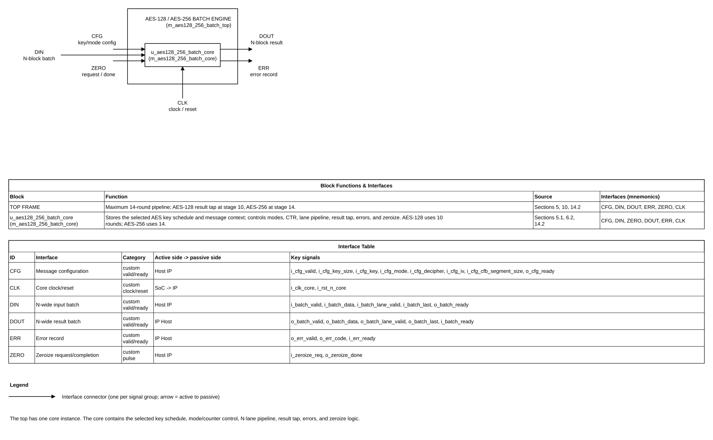

# AES-128/AES-256 High-Throughput Batch Engine Design Specification

Project: AES-128/AES-256 ECB/CBC/CFB/OFB/CTR  
Author: Nguyen Hung Quan (user)  
AI flow: VLSIT ASIC IP MicroSpec  
Date: 2026-10-28

> **Purpose:** Target contract for one message context with run-time AES-128/AES-256 selection and parameterized N-block batches. Open decisions and unmeasured PPA targets are in Section 20.
>
> **shall** is mandatory and testable; **should** is recommended; **may** is optional. Each mandatory requirement has a stable ID and verification method.

## Document map

1. [Purpose, scope, and product context](#1-purpose-scope-and-product-context)
2. [Normative references and precedence](#2-normative-references-and-precedence)
3. [Requirements and traceability](#3-requirements-and-traceability)
4. [Features and configurations](#4-features-and-configurations)
5. [Architecture](#5-architecture)
6. [External interfaces and ports](#6-external-interfaces-and-ports)
7. [Clock, reset, and power](#7-clock-reset-and-power)
8. [Parameters and elaboration configurations](#8-parameters-and-elaboration-configurations)
9. [Data representation and arithmetic](#9-data-representation-and-arithmetic)
10. [Detailed functional behavior](#10-detailed-functional-behavior)
11. [Register and programming model](#11-register-and-programming-model)
12. [Error handling and recovery](#12-error-handling-and-recovery)
13. [Performance, power, and area](#13-performance-power-and-area)
14. [RTL implementation contract](#14-rtl-implementation-contract)
15. [Verification specification](#15-verification-specification)
16. [DFT and testability](#16-dft-and-testability)
17. [Physical design and timing integration](#17-physical-design-and-timing-integration)
18. [Security, safety, and reliability](#18-security-safety-and-reliability)
19. [Requirement-to-verification traceability](#19-requirement-to-verification-traceability)
20. [Assumptions, dependencies, and decisions](#20-assumptions-dependencies-and-decisions)
21. [Glossary](#21-glossary)
22. [References used to shape this template](#22-references-used-to-shape-this-template)

## 1. Purpose, scope, and product context

### 1.1 Purpose and scope

This IP supports one configured message using AES-128 or AES-256. The host selects key size at configuration time, then transfers ordered batches of up to N 128-bit blocks through N lanes. Key size and other message settings remain fixed until the message finishes or is aborted.

Included: AES-128/AES-256 encryption/decryption; ECB, CBC, CFB, OFB, CTR; CFB segment sizes 1, 2, 4, 8, 16, 32, 64, 128 bits; 1-to-4 lane batch interface; configurable CTR field width; backpressure; errors; reset; zeroize.

Excluded: AES-192; padding; partial 128-bit ECB/CBC/OFB/CTR blocks; GCM/authentication; key generation/provisioning; IV/nonce generation; software-visible CSRs; side-channel or fault-injection resistance claims. The system integrator owns authentication, key lifecycle, IV policy, and CTR initial-value uniqueness.

### 1.2 Deployment assumptions

| Item | Specification |
|---|---|
| Target SoC / product class | ASIC accelerator or FPGA prototype; exact SoC TBD |
| Technology / library assumptions | No library supplied; PPA not measured |
| Operating modes and workload | One configured message at a time; N-wide batches |
| Security / privilege context | Direct key input; no CSR or key-manager sideload |
| External dependencies | Host supplies key size, key, mode, direction, IV/counter, traffic, and uniqueness policy |

### 1.3 Feature summary

| Feature ID | Feature | Required / optional | Configuration condition | Requirements |
|---|---|---|---|---|
| FEAT-001 | AES-128 and AES-256 encrypt/decrypt | Required | One-bit key-size choice per message | REQ-FUNC-001/010 |
| FEAT-002 | ECB/CBC/CFB/OFB/CTR | Required | Selected per message | REQ-FUNC-002 |
| FEAT-003 | Pipelined N-lane batch datapath | Required | PARA_AES_LANE_NUM=1..4 | REQ-PERF-001 |
| FEAT-004 | Configurable low-field CTR | Required | PARA_CTR_WIDTH=1..128 | REQ-FUNC-006 |
| FEAT-005 | Synchronous valid/ready interface | Required | All builds | REQ-IF-001 |
| FEAT-006 | Zeroization | Required | Request or reset | REQ-SEC-001 |
| FEAT-007 | AES-192 and GCM | Excluded | Not present | DEC-SCOPE-001 |

## 2. Normative references and precedence

### 2.1 Normative references

| Ref ID | Document and revision | Applicable clauses | Authority / notes |
|---|---|---|---|
| REF-001 | NIST FIPS 197-upd1, May 2023 | §§4–6, Table 3, Appendix A.3, B.3, C.1 and C.3 | AES-128/256 primitive, key schedule, examples; local conversion: ../shared/references/md_doc/nist_fips_197_upd1.md |
| REF-002 | NIST SP 800-38A, December 2001 | §§5–7 and Appendices F.1–F.5 | ECB/CBC/CFB/OFB/CTR; local conversion: ../shared/references/md_doc/nist_sp_800_38a.md |
| REF-003 | VLSIT RTL Design Rules v2 | Applicable rules | ../../../VLSIT_RTL_Generator_AI_Model/spec_template/VLSIT_RTL_Design_Rule.md |
| REF-004 | IEEE 1800-2017 SystemVerilog | Synthesizable subset | Subject to REF-003 and frontend support |
| REF-005 | AES-128 batch specification | Sections 1–22 baseline | ../AES128_ECB_CBC_CFB_OFB_CTR_Design_Specification.md; dual-key specification supersedes key-size/latency assumptions |

These NIST conversions were already approved and downloaded for the AES-128 specification; no new standard download is needed.

### 2.2 Source-of-truth and conflict handling

1. REF-001 defines AES-128/AES-256 primitive and key schedules.
2. REF-002 defines selected mode equations and IV/counter requirements.
3. User-approved decisions define key-size selection, batching, handshakes, errors, reset, and zeroize.
4. This document is the behavior contract; legacy RTL is not a golden source.
5. REF-003 is mandatory.
6. No authentication is provided.
7. Integration values remain TBD in Section 20.

The user approved the default VLSIT RTL rule v2 for this design; it applies without exceptions. The specification follows the default naming rule in Section 2 of VLSIT_RTL_Design_Rule.md v2 at ../../../VLSIT_RTL_Generator_AI_Model/spec_template/VLSIT_RTL_Design_Rule.md.

### 2.3 Compliance declaration

| Standard | Revision / profile | Role implemented | Options | Deviations |
|---|---|---|---|---|
| NIST FIPS 197 | FIPS 197-upd1, 2023 | AES-128 and AES-256 | 128-bit block; 128/256-bit keys | AES-192 omitted |
| NIST SP 800-38A | December 2001 | ECB/CBC/CFB/OFB/CTR | Listed CFB segment subset | No authentication |
| Custom batch interface | Project-defined v0.1 | One message, N lanes | Synchronous valid/ready | Not AMBA/TileLink |

## 3. Requirements and traceability

| ID | Requirement using shall/should/may | Source | Applies to | Verification method |
|---|---|---|---|---|
| REQ-FUNC-001 | The IP shall implement AES-128 (128-bit key, 10 rounds) and AES-256 (256-bit key, 14 rounds) on 128-bit blocks. | REF-001 | All | Independent KATs |
| REQ-FUNC-002 | The IP shall support ECB, CBC, CFB, OFB, and CTR selected per message. | REF-002 | All | Mode reference tests |
| REQ-FUNC-003 | The IP shall preserve batch and lane order. | Product decision | All | Ordered scoreboard |
| REQ-FUNC-004 | The IP shall keep key size, key, mode, direction, IV/counter, and CFB size fixed during a message. | Product decision | All | Assertions |
| REQ-FUNC-005 | The IP shall support CFB segments of 1, 2, 4, 8, 16, 32, 64, or 128 bits. | REF-002 | CFB | Test each size |
| REQ-FUNC-006 | The IP shall increment only the low PARA_CTR_WIDTH bits and keep upper counter bits fixed. | REF-002 App. B | CTR | Counter tests |
| REQ-FUNC-007 | The IP shall reject a CTR batch atomically if any active counter would wrap. | User decision | CTR | Boundary/atomicity tests |
| REQ-FUNC-008 | On a valid configuration handshake, the IP shall derive and store 11 AES-128 or 15 AES-256 round keys; accept no data on that edge; and accept data no earlier than the next rising edge. Decipher shall use reverse key order. | DEC-KEY-003; REF-001 | All | Timing/KAT |
| REQ-FUNC-009 | The IP shall use the configured direction for ECB/CBC; CFB/OFB/CTR shall use AES encryption for both data directions. | REF-001/002 | All | Mode KAT |
| REQ-FUNC-010 | The IP shall use a one-bit i_cfg_key_size selector: 0=AES-128 and 1=AES-256. AES-128 uses i_cfg_key[127:0] and requires [255:128]=0; AES-256 uses all 256 bits. | User decision; REF-001 | All | Mapping and negative tests |
| REQ-FUNC-011 | The AES-256 key schedule shall derive W0..W59 per FIPS 197 Appendix A.3. For i=8..59, set temp=W[i-1]; if i mod 8=0, temp=SubWord(RotWord(temp)) XOR Rcon; else if i mod 8=4, temp=SubWord(temp); then W[i]=W[i-8] XOR temp. K_r shall be {W[4r],W[4r+1],W[4r+2],W[4r+3]} for r=0..14. | REF-001 Appendix A.3 | AES-256 | Key-schedule KAT |
| REQ-IF-001 | The IP shall meet this requirement: accept config only when i_cfg_valid and o_cfg_ready are high at a rising edge. | Product decision | All | Interface assertions |
| REQ-IF-002 | The IP shall meet this requirement: accept a batch only when i_batch_valid and o_batch_ready are high at a rising edge. | Product decision | All | Interface assertions |
| REQ-IF-003 | The IP shall meet this requirement: hold output payload stable during backpressure, except reset or accepted zeroize. | Product decision | All | Stability assertion |
| REQ-IF-004 | The IP shall meet this requirement: accept only nonzero contiguous lane prefixes beginning at lane 0. | Product decision | All | Mask tests |
| REQ-IF-005 | The IP shall meet this requirement: propagate i_batch_last with its corresponding output batch. | Product decision | All | Last-marker tests |
| REQ-CLK-001 | The IP shall meet this requirement: sample functional ports synchronously to i_clk_core except reset assertion. | Product decision | All | CDC/RDC review |
| REQ-RESET-001 | The IP shall meet this requirement: reset asserts asynchronously; SoC synchronizes deassertion before IP input. | User decision | All | SoC/RDC review |
| REQ-RESET-002 | The IP shall meet this requirement: reset aborts work, clears valid state, and prevents stale results. | Product decision | All | Reset-stage tests |
| REQ-PARAM-001 | The IP shall meet this requirement: pARA_AES_LANE_NUM is 1..4, default 4. | User decision | All | Elaborate all values |
| REQ-PARAM-002 | The IP shall meet this requirement: pARA_CTR_WIDTH is 1..128, default 32. | User decision | CTR | Boundary elaboration |
| REQ-ERR-001 | The IP shall meet this requirement: reject illegal mode/CFB size or nonzero AES-128 upper key half with code 1 and no work. | Product decision | All | Error tests |
| REQ-ERR-002 | The IP shall meet this requirement: produce no partial result when rejecting CTR wrap. | Product decision | CTR | Atomicity assertion |
| REQ-ERR-003 | The IP shall hold an error record stable until handshake and shall not accept new work while an error remains pending, except reset/zeroize clears it. | Product decision | All | Error-stability assertion |
| REQ-ERR-004 | The IP shall meet this requirement: report code 5 and perform no work if data is sent without context or after last input. | Product decision | All | Protocol-error test |
| REQ-ERR-005 | A rejected configuration or batch accepted on a valid/ready handshake shall be consumed on that edge; o_err_valid shall assert in the following cycle and remain stable until accepted. | User decision | All | Error timing assertion |
| REQ-SEC-001 | The IP shall meet this requirement: sampled zeroize aborts work, clears sensitive/context/data/valid state and pending error, then pulses done for one cycle; no error code is generated. | User decision | All | Cycle-accurate test |
| REQ-SEC-002 | The IP shall meet this requirement: make no authentication, key provisioning, IV generation, or SCA-resistance claim. | Scope | All | Review |
| REQ-PERF-001 | The IP shall meet this requirement: accept independent blocks at one batch/cycle after fill when no feedback dependency or stall. | User decision | ECB/CTR/CBC decipher | Throughput/STA |
| REQ-PERF-002 | The IP shall meet this requirement: support up to N blocks/cycle for ECB, CTR, CBC decipher. | User decision | Independent modes | N-lane regression |
| REQ-PERF-003 | The IP shall meet this requirement: feedback modes use registered results without bypass; minimum dependent input intervals are 11 cycles AES-128 and 15 AES-256. | User decision | Feedback modes | Cycle assertion |
| REQ-PERF-004 | The IP shall meet this requirement: no-stall latency is 10 cycles AES-128 and 14 AES-256. | User decision | All | Cycle assertion |
| REQ-VER-001 | The IP shall meet this requirement: use independent expected-value model, not generated RTL. | Project policy | All | Testbench review |
| REQ-VER-002 | The IP shall meet this requirement: cover both key sizes, N=1..4, CTR widths 1/32/127/128, all modes/CFB sizes, stalls, reset, zeroize and boundaries. | Verification plan | All | Regression/coverage |
## 4. Features and configurations

| Configuration ID | Enabled features | Disabled features | Interfaces / widths | Intended use | Verification target |
|---|---|---|---|---|---|
| CFG-AES128-N | AES-128, five modes, N lanes, valid/ready, zeroize | AES-192, GCM, CSR | N×128-bit data; 256-bit key input uses low half; N=1..4 | AES-128 message | N=1..4 |
| CFG-AES256-N | AES-256, five modes, N lanes, valid/ready, zeroize | AES-192, GCM, CSR | N×128-bit data; full 256-bit key; N=1..4 | AES-256 message | N=1..4 |
| CFG-CTR32 | Either key size; PARA_CTR_WIDTH=32 | Other counter widths in build | 128-bit initial counter; low 32 bits increment | Default CTR | Counter boundaries |
| CFG-CTR-BOUND | Either key size; PARA_CTR_WIDTH=1 or 128 | None | 128-bit initial counter | Counter boundary builds | Width/wrap tests |

Key size is selected at run time per message. Lane count and CTR field width are elaboration settings. Default build: four lanes and a 32-bit CTR field.

## 5. Architecture

### 5.1 Overview and block responsibilities

The IP holds one message context and accepts ordered batches of up to N blocks. Each lane has a shared encrypt/decrypt AES pipeline with a maximum of 14 registered round stages. The selected key size determines the active endpoint: AES-128 uses stages 1–10 and presents its result after C10; AES-256 uses stages 1–14 and presents its result after C14. A batch accepted at C0 is captured by the input register at C0; round registers capture at C1 through C10 or C14. Independent blocks can enter at one batch per cycle after fill. Feedback modes wait for the registered result: the minimum no-stall dependent input interval is 11 cycles for AES-128 and 15 cycles for AES-256. No combinational feedback bypass is used.

At configuration acceptance, the key expander derives and stores 11 AES-128 or 15 AES-256 round keys. AES-128 uses i_cfg_key[127:0]; i_cfg_key[255:128] must be zero. AES-256 uses all 256 bits. Configuration handshake occurs at C0; data can first handshake at C1. The combinational key-expansion path ends at context registers and requires STA.

| Module | Responsibility | Parent / instance | Clock/reset domain | State or storage |
|---|---|---|---|---|
| m_aes128_256_batch_top | Structural top; one core instance only | Structural top | CLK-CORE/RST-CORE | None |
| m_aes128_256_batch_core | Context, keys, config/batch control, modes, counter, errors, zeroize, result postprocessing | m_aes128_256_batch_top / u_aes128_256_batch_core | CLK-CORE/RST-CORE | Up to 15 round keys, feedback/counter/context |
| m_aes128_256_key_expand | Combinational AES-128/AES-256 key schedule | m_aes128_256_batch_core / u_aes128_256_key_expand | Combinational | None |
| m_aes128_256_lane_array | N lane pipelines, batch ready/valid, aligned metadata | m_aes128_256_batch_core / u_aes128_256_lane_array | CLK-CORE/RST-CORE | Lane pipeline state |
| m_aes128_256_pipe_lane | Input capture register and up to 14 shared round stages | m_aes128_256_lane_array / u_aes128_256_pipe_lane_0..N-1 | CLK-CORE/RST-CORE | Data, valid, sideband, result |
| m_aes128_256_aes_round | One combinational forward/inverse AES round | m_aes128_256_pipe_lane / u_aes128_256_aes_round_0..13 | Combinational | None |

The lane pipeline uses stages 1–10 for AES-128; stages 11–14 are inactive for that context. AES-256 uses all 14 stages. Stage 10 or 14, selected by key size, is the output storage boundary. Direction-selectable logic shares pipeline storage/control, but forward and inverse transforms differ; no fixed area saving is claimed.

### 5.2 Block diagram

*Figure 5-1. AES-128/AES-256 one-message N-block batch architecture. Source: `figures/aes128_aes256_batch_architecture.drawio` (draw.io, VLSIT library, drawn by `vlsit_spec_diagram.py`). The frame is the top module, the blocks are its instances, each connector is one interface with its mnemonic, and the two tables under the diagram in the source file describe the blocks and the interfaces.* This is the top-level boundary view; pipeline taps and nested module responsibilities are detailed in Sections 5.1 and 14.2.

### 5.3 Transaction and dataflow

1. Host submits key size, key, mode, direction, initial IV/counter, and CFB size.
2. On valid configuration handshake, IP validates fields, derives/captures the selected round keys, and records context.
3. First data batch may handshake at the next rising edge.
4. Host sends 1..N complete blocks with a nonzero contiguous lane prefix.
5. Core prepares mode inputs and counter values; lane array captures active blocks and metadata.
6. AES-128 results emerge after 10 cycles; AES-256 results after 14, absent stalls.
7. Core completes mode postprocessing and returns ordered results.
8. Output remains stable during backpressure. Final output handshake releases the message context.
9. Accepted zeroize aborts work and clears sensitive state and pending output/error records.

### 5.4 Invariants

- At most one message context is active; key size and fields remain fixed.
- AES-128 uses 11 round keys and 10-cycle latency; AES-256 uses 15 keys and 14-cycle latency.
- Lane 0 is earliest; batches and lanes return in order.
- Legal lane masks are nonzero contiguous prefixes.
- CTR wrap rejects the entire batch before processing.
- Backpressure cannot drop, duplicate, or reorder results.
- Reset/zeroize clear valid state and prevent stale output.
- N-lane throughput applies only when the mode has no inter-block dependency.

## 6. External interfaces and ports

### 6.1 Interface inventory

| Interface ID | Type and revision | Role | Direction at IP boundary | Clock domain | Required / optional | Configurations |
|---|---|---|---|---|---|---|
| IF-CFG | Custom valid/ready | Configure one message and select key size | Bidirectional | CLK-CORE | Required | All |
| IF-DATA | Custom N-wide valid/ready | Transfer ordered batches | Bidirectional | CLK-CORE | Required | All |
| IF-ERR | Custom error ready/valid | Report rejected transactions | Bidirectional | CLK-CORE | Required | All |
| IF-ZERO | Zeroize request/completion | Abort and clear state | Bidirectional | CLK-CORE | Required | All |

These project-defined interfaces are not AMBA or TileLink.

### 6.2 Complete port list

| Port | Direction | Width | Meaning (function) | Clock domain | Signal type | Reset / idle value | Timing / sampling | Configurations |
|---|---|---:|---|---|---|---|---|---|
| i_clk_core | Input | 1 | Core clock | CLK-CORE | Clock | Not applicable (clock has no reset value) | Rising edge | All |
| i_rst_n_core | Input | 1 | Active-low core reset | RST-CORE | Reset | 0 in reset | Async assert; SoC-synchronized release | All |
| i_cfg_valid | Input | 1 | Configuration valid | CLK-CORE | Level | 0 | Hold fields until ready | All |
| o_cfg_ready | Output | 1 | Configuration can be accepted | CLK-CORE | Level | 0 in reset | Handshake | All |
| i_cfg_key_size | Input | 1 | 0 selects AES-128; 1 selects AES-256 | CLK-CORE | Data | 0 | Config handshake | All |
| i_cfg_key | Input | 256 | AES key; AES-128 uses low half and requires high half zero | CLK-CORE | Data | 0 recommended | Config handshake | All |
| i_cfg_mode | Input | 3 | 0 ECB, 1 CBC, 2 CFB, 3 OFB, 4 CTR | CLK-CORE | Data | 0 | Config handshake | All |
| i_cfg_decipher | Input | 1 | 0 encrypt; 1 decipher for ECB/CBC | CLK-CORE | Data | 0 | Config handshake | All |
| i_cfg_iv | Input | 128 | IV or initial counter; ignored in ECB | CLK-CORE | Data | 0 | Config handshake | All |
| i_cfg_cfb_segment_size | Input | 4 | CFB segment code 0..7 maps to 1..128 bits | CLK-CORE | Data | 0 | Config handshake | CFB |
| i_batch_valid | Input | 1 | Input batch valid | CLK-CORE | Level | 0 | Hold payload until ready | All |
| o_batch_ready | Output | 1 | Input batch can be accepted or rejected through a handshake | CLK-CORE | Level | 0 in reset | High in idle or after the final input to consume and report an invalid batch; follows pipeline capacity during an active message; low during reset, zeroize, a configuration handshake edge, or while an error is pending | Handshake | All |
| i_batch_data | Input | 128 × PARA_AES_LANE_NUM | Packed blocks; lane 0 is [127:0] | CLK-CORE | Data | 0 | Input handshake | All |
| i_batch_lane_valid | Input | PARA_AES_LANE_NUM | Active contiguous lane prefix | CLK-CORE | Data | 0 | Input handshake | All |
| i_batch_last | Input | 1 | Final input batch | CLK-CORE | Data | 0 | Input handshake | All |
| o_batch_valid | Output | 1 | Result batch valid | CLK-CORE | Level | 0 in reset/idle | Hold until ready | All |
| i_batch_ready | Input | 1 | Host accepts result | CLK-CORE | Level | 0 | Handshake | All |
| o_batch_data | Output | 128 × PARA_AES_LANE_NUM | Ordered result blocks | CLK-CORE | Data | Invalid when valid=0 | Stable during stall | All |
| o_batch_lane_valid | Output | PARA_AES_LANE_NUM | Active result lanes | CLK-CORE | Data | 0 | Stable with result | All |
| o_batch_last | Output | 1 | Final result marker | CLK-CORE | Data | 0 | Stable with result | All |
| o_err_valid | Output | 1 | Error record valid | CLK-CORE | Level | 0 | Hold until ready; reset/zeroize clears | All |
| i_err_ready | Input | 1 | Host accepts error | CLK-CORE | Level | 0 | Handshake | All |
| o_err_code | Output | 4 | Error code | CLK-CORE | Data | 0 | Stable while valid | All |
| i_zeroize_req | Input | 1 | Abort/clear request | CLK-CORE | Pulse | 0 | Sampled on rising edge | All |
| o_zeroize_done | Output | 1 | Zeroize completion pulse | CLK-CORE | Pulse | 0 | High one cycle immediately after sample/clear edge | All |

### 6.3 Protocol behavior

Configuration is accepted only when i_cfg_valid and o_cfg_ready are high at a rising edge. Host holds fields stable until handshake. i_cfg_key_size=0 selects AES-128; i_cfg_key[127:0] is the key and [255:128] must be zero. A nonzero high half causes error 1 and no context. i_cfg_key_size=1 selects AES-256 and uses all 256 bits. Key size is fixed for the message. Earliest data handshake is the next rising edge after valid configuration. On the configuration handshake edge, o_batch_ready is low; a simultaneously asserted i_batch_valid is not accepted and must remain asserted until a later handshake.

A batch is accepted only on i_batch_valid/o_batch_ready. When no message context exists, o_batch_ready is high (except during reset, zeroize, a configuration handshake edge, or while an error is pending) so an unsolicited batch can be consumed and reported as error 5. After i_batch_last is accepted, o_batch_ready is also high to consume and report any extra batch, even while earlier accepted results are draining. A rejected extra batch performs no AES work and does not discard results from previously accepted batches. For N=4, legal masks are 0001, 0011, 0111, and 1111; smaller N uses a nonzero prefix. Lane 0 is earliest. Partial blocks are unsupported except CFB segments, which are left-justified in lane 0; unused lower input bits are ignored and output bits are zero.

ECB, CTR, and CBC decipher can process independent blocks in parallel. CBC encryption, CFB, and OFB use lane 0 only and wait for prior feedback. Output data/mask/last stay stable while valid and not ready, except reset or accepted zeroize. Error records stay stable until handshake, except reset/zeroize. While an error is pending, the IP accepts no new config or batch. Zeroize clears pending output/error valid and creates no error record.

| Case | Legal behavior | Illegal case | IP response | Requirement |
|---|---|---|---|---|
| Key size | 0 AES-128; 1 AES-256 | None | Both values valid | REQ-FUNC-010 |
| AES-128 key | Upper half zero | Any nonzero upper bit | Error 1; no context | REQ-ERR-001 |
| Mode | 0..4 | 5..7 | Error 1 | REQ-ERR-001 |
| CFB segment | Codes 0..7 | Codes 8..15 | Error 1 | REQ-FUNC-005 |
| Lane mask | Nonzero prefix | Zero or holes | Error 2; no work | REQ-IF-004 |
| CTR | All used counters fit | Any active counter wraps | Reject batch; error 3 | REQ-FUNC-007 |
| Protocol | Data inside active context before/through last batch | Data without context or after last | Error 5; no work | REQ-ERR-004 |
| Zeroize | Sampled high at rising edge | None | Abort, clear, done pulse; no error | REQ-SEC-001 |

### 6.4 Interrupts and events

No interrupt is defined. Errors and zeroize completion use listed ports. CSR/interrupt wrapper is outside this IP.

## 7. Clock, reset, and power

### 7.1 Clock domains

| Domain | Clock port | Edge | Frequency range | Source | Relationship | Gating policy |
|---|---|---|---|---|---|---|
| CLK-CORE | i_clk_core | Rising | TBD by SoC | SoC clock controller | Single synchronous domain | No RTL clock gating |

### 7.2 CDC and RDC

No functional CDC is defined. Functional ports are synchronous to CLK-CORE. Any asynchronous host requires an integration wrapper and CDC/RDC checks. SoC synchronizes reset deassertion before the IP boundary.

| Crossing ID | From → to | Signals | Structure | Reset handling | Verification |
|---|---|---|---|---|---|
| CDC-001 | Host → CLK-CORE | Functional ports | Synchronous host or wrapper | Wrapper-owned | CDC/RDC review |

### 7.3 Reset domains and sequencing

| Reset ID | Port | Polarity / assertion | Sync or async | Scope | Deassertion | Reset value |
|---|---|---|---|---|---|---|
| RST-CORE | i_rst_n_core | Active-low async assertion | Async assert / SoC-synchronized release | Context, key schedule, pipeline/output valid, controls | Synchronous before IP boundary | Valid/status outputs 0 |

Reset aborts the message, clears valid and sensitive state, and prevents stale results. IP uses i_rst_n_core directly; no internal reset synchronizer is instantiated.

### 7.4 Power intent

RTL shall not implement power gating, retention, isolation, or clock gating. SoC-level power intent and targets are integration dependencies.

## 8. Parameters and elaboration configurations

Parameters shall follow REF-003 declaration and comment rules.

| Parameter | Purpose | Default | Legal range | Effect |
|---|---|---:|---|---|
| PARA_AES_LANE_NUM | Parallel 128-bit lane count | 4 | 1..4 | Changes batch/mask widths and replicated area |
| PARA_CTR_WIDTH | Low CTR field width | 32 | 1..128 | Only low bits increment; upper bits stay fixed |

Default data width is 512 bits and mask width is 4. N=1 uses 128-bit data and a one-bit mask. Illegal values shall fail elaboration with a diagnostic. Key size is a runtime message setting via i_cfg_key_size.

| Configuration | Parameter values | Expected hierarchy | Elaboration target |
|---|---|---|---|
| CFG-N1 | PARA_AES_LANE_NUM=1, PARA_CTR_WIDTH=32 | One lane | Required |
| CFG-N4 | PARA_AES_LANE_NUM=4, PARA_CTR_WIDTH=32 | Four lanes | Default; required |
| CFG-CTR1 | PARA_AES_LANE_NUM=4, PARA_CTR_WIDTH=1 | Four lanes | Required |
| CFG-CTR128 | PARA_AES_LANE_NUM=4, PARA_CTR_WIDTH=128 | Four lanes | Required |

## 9. Data representation and arithmetic

| Quantity | Width | Encoding / range | Extension / truncation | Invalid behavior |
|---|---:|---|---|---|
| AES block | 128 | FIPS byte/state ordering | None | Complete blocks except CFB |
| AES key input | 256 | Selector 0: low 128; selector 1: all 256 | AES-128 high half must be zero | Error 1 |
| Key-size selector | 1 | 0 AES-128; 1 AES-256 | None | Both legal |
| AES-128 schedule | 11 × 128 | K0..K10 | Captured at config | Not applicable (key schedule is data) |
| AES-256 schedule | 15 × 128 | K0..K14 | Captured at config | Not applicable (key schedule is data) |
| Mode | 3 | 0 ECB, 1 CBC, 2 CFB, 3 OFB, 4 CTR | None | 5..7 rejected |
| CFB size | 4 | 0→1, 1→2, 2→4, 3→8, 4→16, 5→32, 6→64, 7→128 bits | MSB-aligned | 8..15 rejected |
| Lane i | 128 | Slice [128*i +: 128] | None | Mask controls validity |
| CTR initial block | 128 | Upper bits fixed; low PARA_CTR_WIDTH bits count | None | Reject before wrap |
| Active lane count | 1..N | Contiguous prefix population | Counter advances by count | Reject whole batch if wrap |

AES byte/state ordering follows FIPS 197. CTR follows SP 800-38A Appendix B; only the configured low counter field increments. Host ensures initial values do not repeat under the same key; IP detects local field exhaustion only.

## 10. Detailed functional behavior

### 10.1 Modes and state transitions

| State | Entry condition | Behavior | Exit condition |
|---|---|---|---|
| IDLE | Reset released; no context | Accept and validate config | Config handshake |
| ACTIVE-INDEPENDENT | ECB, CTR, CBC decipher | Accept independent blocks across N lanes | Last input accepted |
| ACTIVE-FEEDBACK | CBC encrypt, CFB, OFB | Accept lane 0 when feedback is available | Last input accepted |
| DRAIN | Results remain | Preserve order/backpressure | Last output handshake |
| ERROR | Invalid config/batch | Hold error record | Error handshake |
| ZEROIZE | Request sampled high | Abort and clear sensitive/valid state | Done pulse |
| RESET | Reset asserted | Abort and clear state | SoC-synchronized release |

### 10.2 Operations

| Operation | Processing semantics | Result | No-stall latency / rate |
|---|---|---|---|
| ECB | Each block uses configured AES direction | Ordered batch | 10 cycles AES-128; 14 AES-256; II=1 |
| CBC encrypt | XOR with IV/prior ciphertext, then AES encrypt | Lane-0 ciphertext | Latency 10/14; dependent interval 11/15 cycles |
| CBC decrypt | AES decipher, XOR with prior ciphertext/IV | Up to N plaintexts | Latency 10/14; II=1 |
| CFB | AES encrypt feedback; XOR top s bits; shift ciphertext segment into feedback | Left-justified s-bit output | Latency 10/14; interval 11/15 |
| OFB | AES encrypt feedback; XOR data; update feedback | One 128-bit output | Latency 10/14; interval 11/15 |
| CTR | AES encrypt counters and XOR input blocks | Up to N results | Latency 10/14; II=1 |
| Zeroize | Abort and clear sensitive/valid state on sampled request edge | Done pulse for next cycle | Overrides normal processing |

Mode equations follow REF-002. Let E_K and D_K denote AES encryption and decipher under the configured key. AES-128 uses 10 rounds; AES-256 uses 14. Padding is external. No partial OFB/CTR block or GCM tag is supported.

- ECB: C_i=E_K(P_i); P_i=D_K(C_i).
- CBC: C_i=E_K(P_i XOR C_(i-1)); P_i=D_K(C_i) XOR C_(i-1), with C_(-1)=IV. For parallel CBC decipher, lane i carries the preceding ciphertext; lane 0 uses the saved previous ciphertext or IV.
- CFB-s: R_0=IV; Z_i=E_K(R_i); encryption Cseg_i=Pseg_i XOR MSB_s(Z_i); decipher Pseg_i=Cseg_i XOR MSB_s(Z_i); R_(i+1)=LSB_(128-s)(R_i) concatenated with the input ciphertext segment. Segment bits occupy [127:128-s]; unused low output bits are zero. The configured direction does not select AES decipher in CFB.
- OFB: R_0=IV; S_i=E_K(R_i); C_i=P_i XOR S_i; R_(i+1)=S_i. Decipher uses the same XOR transform.
- CTR: C_i=P_i XOR E_K(counter_i); decipher uses the same transform with ciphertext as input. i_cfg_decipher does not select AES decipher for CTR. Counter allocation and low-field exhaustion are defined below.

For OFB, IV is R_0 and the first keystream block is E_K(R_0). For CFB and OFB, only one lane is active per feedback transaction.

For CTR, lane 0 uses the current base; lane i uses base+i. Addition affects only the low PARA_CTR_WIDTH bits; upper bits stay fixed. After acceptance the base advances by active-lane count. If any active counter would wrap, reject the entire batch before AES processing. A batch may consume the maximum counter value; a subsequent wrapping batch is rejected. Lane 0 is earliest; output mask and last marker correspond to input.

### 10.3 Cycle-level behavior

The user approved this 12-scenario waveform plan on 2026-10-28, before figures were drawn. C0 is the input-batch handshake edge. With no stall, AES-128 output valid asserts after C10 and AES-256 after C14. Dependent feedback input is next accepted at C11 or C15. Zeroize clears on the sampling edge and asserts done for the following one-cycle interval.

| Waveform ID | Function / operation | Scenario | Figure |
|---|---|---|---|
| WF-001 | Configuration | AES-128/AES-256 success and AES-128 nonzero upper-key rejection | [SVG](figures/waveforms/WF-001_config_key_select.svg) ([JSON](figures/waveforms/WF-001_config_key_select.json)) |
| WF-002 | OP-ECB AES-128 | Continuous batches; stage-10 latency and II=1 | [SVG](figures/waveforms/WF-002_aes128_ecb.svg) ([JSON](figures/waveforms/WF-002_aes128_ecb.json)) |
| WF-003 | OP-ECB AES-256 | Continuous batches; stage-14 latency and II=1 | [SVG](figures/waveforms/WF-003_aes256_ecb.svg) ([JSON](figures/waveforms/WF-003_aes256_ecb.json)) |
| WF-004 | OP-CTR | Lane counter allocation for partial batch | [SVG](figures/waveforms/WF-004_ctr_allocate.svg) ([JSON](figures/waveforms/WF-004_ctr_allocate.json)) |
| WF-005 | OP-CTR | Atomic counter-wrap rejection, no partial output | [SVG](figures/waveforms/WF-005_ctr_wrap.svg) ([JSON](figures/waveforms/WF-005_ctr_wrap.json)) |
| WF-006 | OP-CBC-DEC | N-block decryption for both key sizes | [AES-128 SVG](figures/waveforms/WF-006a_cbc_decrypt.svg) ([JSON](figures/waveforms/WF-006a_cbc_decrypt.json)); [AES-256 SVG](figures/waveforms/WF-006b_cbc_decrypt.svg) ([JSON](figures/waveforms/WF-006b_cbc_decrypt.json)) |
| WF-007 | OP-CBC-ENC | AES-128 feedback: input C0, result C10, next input C11 | [SVG](figures/waveforms/WF-007_cbc_encrypt_feedback.svg) ([JSON](figures/waveforms/WF-007_cbc_encrypt_feedback.json)) |
| WF-008 | OP-CFB | AES-256 feedback: input C0, result C14, next input C15 | [SVG](figures/waveforms/WF-008_cfb_feedback.svg) ([JSON](figures/waveforms/WF-008_cfb_feedback.json)) |
| WF-009 | OP-OFB | AES-256 feedback and output | [SVG](figures/waveforms/WF-009_ofb_feedback.svg) ([JSON](figures/waveforms/WF-009_ofb_feedback.json)) |
| WF-010 | Backpressure | One-cycle output stall at both result taps | [AES-128 SVG](figures/waveforms/WF-010a_backpressure.svg) ([JSON](figures/waveforms/WF-010a_backpressure.json)); [AES-256 SVG](figures/waveforms/WF-010b_backpressure.svg) ([JSON](figures/waveforms/WF-010b_backpressure.json)) |
| WF-011 | Lane/protocol error | Invalid mask and data without context/after last | [SVG](figures/waveforms/WF-011_lane_mask_error.svg) ([JSON](figures/waveforms/WF-011_lane_mask_error.json)) |
| WF-012 | Reset/zeroize | Abort during work or output stall | [Reset SVG](figures/waveforms/WF-012a_reset_abort.svg) ([JSON](figures/waveforms/WF-012a_reset_abort.json)); [zeroize SVG](figures/waveforms/WF-012b_zeroize_abort.svg) ([JSON](figures/waveforms/WF-012b_zeroize_abort.json)) |

The 12 approved scenarios are rendered as 15 SVGs because CBC decryption, output backpressure, and reset/zeroize each have separate AES-128/AES-256 or reset/zeroize examples.

| Event | Input condition | Action/output |
|---|---|---|
| Config C0 | Config valid and ready | Capture 11 or 15 keys; no batch accepted on C0 |
| Earliest data C1 | Batch valid and ready | Capture first batch |
| AES-128 C0+10 | No stalls | Result valid after C10 |
| AES-256 C0+14 | No stalls | Result valid after C14 |
| Feedback next input | Prior result registered | Earliest C11 AES-128 / C15 AES-256 |
| Output stall | Valid and not ready | Hold payload stable |
| Zeroize E0 | Request sampled | Clear on E0; done high next cycle |
### 10.4 Arbitration, buffering, and throughput

One message context is active; there is no cross-message arbitration. ECB, CTR, and CBC decipher can accept one batch/cycle after fill when output is not stalled. Peak bit rate is 128 × N × FCLK; no numeric rate is claimed.

CBC encryption, CFB, and OFB depend on prior results. Their minimum no-stall dependent input intervals are 11 cycles for AES-128 and 15 for AES-256. One output batch register is placed at the selected stage 10 or 14; backpressure propagates upstream.

### 10.5 Memories and storage

| Storage ID | Kind | Depth × width | Ports | Read latency | Reset/init | Implementation |
|---|---|---|---|---|---|---|
| MEM-PIPE | AES pipeline registers | Per lane: input capture plus up to 14 round stages and metadata | Register stages | One round stage/clock after capture | Clear valid/sensitive state | Flops |
| MEM-CTX | One message context | Up to 15 × 128-bit keys (1920 bits), mode/IV/counter/feedback | Internal | Register | Reset/zeroize clear | Flops |
| MEM-OUT | Output storage | One batch × N blocks and metadata at stage 10 or 14 | Ready/valid | Selected output stage | Clear valid/payload | Flops; no SRAM |

## 11. Register and programming model

This IP has no software-visible registers or CSR interface. Configuration uses IF-CFG and data uses IF-DATA. Host supplies key size, key, mode, direction, IV/counter, and CFB segment size. Any SoC-level CSR wrapper is outside this IP.

## 12. Error handling and recovery

| Error ID | Detection condition | Response | Recovery |
|---|---|---|---|
| ERR-CFG | Nonzero AES-128 key upper half, illegal mode, or illegal CFB code | Error code 1; no context | Consume error and submit valid config |
| ERR-LANE | Zero, hole, or mode-illegal lane mask | Error code 2; no work | Correct and resubmit |
| ERR-CTR-WRAP | Any active lane exceeds low-field maximum | Error code 3; atomic batch rejection | Start valid message/counter |
| ERR-RESERVED | Reserved | Code 4 is not generated | Not applicable (reserved code) |
| ERR-PROTO | Data without context or after final input, accepted by valid/ready handshake | Consume the rejected batch, perform no AES work for it, and report error code 5 next cycle; preserve outputs from earlier accepted batches | Consume error and reconfigure |

A rejected configuration or batch is consumed on its valid/ready handshake; o_err_valid asserts in the following cycle. The error record remains stable until accepted. Reset or accepted zeroize clears the record. Only one error may be outstanding; new work cannot overwrite it. Zeroize overrides processing, invalidates stalled output and a pending error, and is acknowledged only by o_zeroize_done.

## 13. Performance, power, and area

| Metric | Target / limit | Conditions | Measurement | Status |
|---|---|---|---|---|
| Maximum frequency | TBD | Library/corner/SDC required | STA | Open |
| Area | TBD; expected to increase with lane count and key schedule | N=1..4 | Mapped/placed area | Open |
| Power | TBD | Activity/corner required | VCD/SAIF analysis | Open |
| Independent initiation interval | 1 batch/cycle after fill | ECB/CTR/CBC decipher; no stall | Simulation/STA | Architecture target |
| Peak throughput | Up to N blocks/cycle | Independent lanes active | Throughput regression | Architecture target |
| Feedback interval | 11 cycles AES-128; 15 AES-256 | CBC encrypt/CFB/OFB; no stall | Cycle simulation | Hard contract |
| Latency | 10 cycles AES-128; 14 AES-256 | No stalls | Cycle simulation/STA | Hard contract |

No frequency, area, or power result is claimed without target library, corners, constraints, tool versions, and activity assumptions.

## 14. RTL implementation contract

### 14.1 Required coding baseline

RTL shall follow VLSIT RTL Design Rules v2 at ../../../VLSIT_RTL_Generator_AI_Model/spec_template/VLSIT_RTL_Design_Rule.md. Use one synthesizable module per matching .sv file; structural top only; ANSI ports; input wire/output logic; unsigned four-state logic; always_comb/continuous assignments and always_ff; named connections; zero-based static generate loops; required process prefixes and parameter comments. No packages, signed/two-state types, plain always, latches, define/undef, implicit nets, or unsupported constructs. Testbench/SVA stays outside synthesizable RTL.

### 14.2 RTL hierarchy

| Module | Responsibility | Parent / instance | Clock/reset | Interface |
|---|---|---|---|---|
| m_aes128_256_batch_top | Structural top; one core instance only | Structural top | CLK-CORE/RST-CORE | Section 6.2 |
| m_aes128_256_batch_core | Context, keys, config/data, modes, counter, errors, zeroize, result processing | m_aes128_256_batch_top / u_aes128_256_batch_core | CLK-CORE/RST-CORE | Same ports as top |
| m_aes128_256_key_expand | Combinational AES-128/AES-256 key expansion | m_aes128_256_batch_core / u_aes128_256_key_expand | Combinational | Key-size and 256-bit key; 1920-bit schedule |
| m_aes128_256_lane_array | N generated lanes, batch handshakes, metadata | m_aes128_256_batch_core / u_aes128_256_lane_array | CLK-CORE/RST-CORE | N-block batches |
| m_aes128_256_pipe_lane | Input capture plus up to 14 shared round stages | m_aes128_256_lane_array / u_aes128_256_pipe_lane_0..N-1 | CLK-CORE/RST-CORE | One block, key vector, valid/ready |
| m_aes128_256_aes_round | Combinational forward/inverse AES round | m_aes128_256_pipe_lane / u_aes128_256_aes_round_0..13 | Combinational | State, key, direction, round index |

Top contains only the core. Core owns mode, counter, output, error, and zeroize control. Generated lane and physical round-stage indices start at zero. AES-128 uses the first 10 round stages and AES-256 uses all 14.

#### 14.2.1 Parameters and module ports

Top and core use PARA_AES_LANE_NUM=4 (range 1..4) and PARA_CTR_WIDTH=32 (range 1..128). Their external ports match Section 6.2.

| Module | Parameters | Inputs | Outputs | Behavior |
|---|---|---|---|---|
| key_expand | None | key size, key[255:0] | round_keys[1919:0] | AES-128 K0..K10 in low 1408 bits; AES-256 K0..K14 in all 1920 bits |
| lane_array | PARA_AES_LANE_NUM | Clock/reset/clear, batches, metadata, keys, key size, direction, ready | Batch ready/valid/data/metadata | Aligns sideband and backpressure |
| pipe_lane | None | Clock/reset/clear, data/sideband, key vector, key size, direction, valid/ready | Ready/valid/data/sideband | Captures input at C0; result tap stage 10/C10 or 14/C14 |
| aes_round | PARA_AES_ROUND_IDX (0..13; round number = index+1) | State/key/direction | State | Final active round omits MixColumns or InvMixColumns; initial AddRoundKey is folded into stage-1 input logic |

ECB/CBC use configured direction. CFB/OFB/CTR use AES encryption. Pipeline storage/control is shared; no fixed area saving is claimed.

### 14.3 Synthesis assumptions

| Item | Value / source |
|---|---|
| Top / file list | m_aes128_256_batch_top; order: aes_round, pipe_lane, lane_array, key_expand, batch_core, batch_top |
| Frontend | TBD; IEEE 1800-2017 subject to REF-003 |
| Parameters | PARA_AES_LANE_NUM=4; PARA_CTR_WIDTH=32 |
| Libraries/corners | TBD; required for PPA/STA |
| Memory | Flop-based; no SRAM required |
| Lint | VLSIT RTL Design Rules v2; checker version recorded by integration |

## 15. Verification specification

### 15.1 Scope and strategy

Verification shall be independent of generated RTL. Use independent AES-128/AES-256 and mode models plus NIST known-answer vectors. Expected values shall not come from DUT outputs or RTL internals. Planned levels include directed/random simulation, assertions, scoreboard, parameter elaboration, lint, synthesis checks, and formal control invariants. This specification authoring does not claim RTL or simulation execution.

### 15.2 Requirement-based test plan

| Test ID | Requirement | Scenario | Expected result | Type/config |
|---|---|---|---|---|
| TEST-AES-001 | REQ-FUNC-001/010 | AES-128 encrypt/decrypt KAT; high key half zero | Exact output; latency 10 | Directed; N=1,4 |
| TEST-AES-002 | REQ-FUNC-001/010/011 | AES-256 encrypt/decrypt KAT | Exact output; latency 14 | Directed; N=1,4 |
| TEST-KEY-001 | REQ-FUNC-010/ERR-001 | Key placement and nonzero AES-128 high half | Correct accept/reject | Directed |
| TEST-MODE-001 | REQ-FUNC-002/009 | NIST vectors for five modes | Correct result/state | Both key sizes |
| TEST-LANE-001 | REQ-IF-004/PARAM-001 | N=1..4 and legal masks | Correct order | Directed/random |
| TEST-CTR-001 | REQ-FUNC-006/007/PARAM-002 | Widths 1,32,127,128 near wrap | Correct count; atomic reject | Both key sizes |
| TEST-CBC-001 | REQ-PERF-002 | N independent ciphertext blocks | Correct plaintext | N=1..4; both keys |
| TEST-FEEDBACK-001 | REQ-PERF-003/004 | CBC encrypt, CFB sizes, OFB | Latency 10/14; interval 11/15 | Directed/assertion |
| TEST-BP-001 | REQ-IF-003 | Stall both output taps | Stable output/no loss | N=1,4 |
| TEST-RESET-001 | REQ-RESET-002 | Reset at each pipeline stage | No stale output | Both keys |
| TEST-ZERO-001 | REQ-SEC-001 | Zeroize during work/stall/pending error | Abort, clear, done, no error code | Directed/assertion |
| TEST-ERR-001 | REQ-ERR-001..005 | Bad key/config/mask/wrap/protocol | Correct error/no partial output | Directed |
| TEST-ORDER-001 | REQ-FUNC-003 | Unique data under stalls | No loss/duplication/reorder | Random; N=1..4 |
| TEST-PERF-001 | REQ-PERF-001 | Sustained independent batch acceptance after fill | One batch/cycle when unstalled | N=1..4 |
| TEST-VERIFY-001 | REQ-VER-001 | Review reference model and generated tests are independent of RTL | Review passes | Verification sources |

### 15.3 Assertions and coverage

| ID | Intent | Requirement | Acceptance |
|---|---|---|---|
| SVA-HS-001 | Input stable while valid and not ready | REQ-IF-001/002 | No failure |
| SVA-HS-002 | Output stable while stalled | REQ-IF-003 | No failure |
| SVA-LAT-001 | No-stall latency equals 10 or 14 by key size | REQ-PERF-004 | No failure |
| SVA-ORD-001 | Batches return in order | REQ-FUNC-003 | No mismatch |
| SVA-CTR-001 | Fixed upper bits; no silent wrap | REQ-FUNC-006/007 | Proof or boundary pass |
| SVA-ZERO-001 | Reset/zeroize prevent stale valid output | REQ-RESET-002/SEC-001 | No stale output |
| SVA-ERR-001 | Error record holds until handshake or flush | REQ-ERR-003 | No failure |
| COV-KEY-001 | Both keys, directions, mapping error | REQ-FUNC-001/010 | All bins |
| COV-MODE-001 | All modes/directions | REQ-FUNC-002 | All bins |
| COV-LANE-001 | N and legal masks | REQ-PARAM-001/IF-004 | All bins |
| COV-CTR-001 | Widths and boundaries | REQ-PARAM-002/FUNC-007 | All bins |
| COV-BP-001 | Backpressure at both result taps | REQ-IF-003 | All bins |
| COV-REG-001 | Regression bins for both key sizes, modes, lanes, errors, and stalls | REQ-VER-002 | All planned bins hit |

No numeric code-coverage target is set. The future verification flow shall report code and functional coverage separately and keep testbenches and run commands in one Makefile.

### 15.4 Formal, CDC, and RDC

| Analysis | Scope | Assumptions | Method |
|---|---|---|---|
| Formal | Handshake, masks, wrap, key-size latency, reset/zeroize | One clock; reset initially asserted | Assertions/proof |
| CDC/RDC | Top and wrapper | Synchronous host; SoC releases reset | CDC/RDC tools |
| Lint/elaboration | N=1..4, CTR bounds, both key-size branches | Fixed frontend/filelist | VLSIT checker/lint |
| Synthesis | Default/boundary builds | Target library/corner required | Synthesis/STA |

## 16. DFT and testability

| Topic | Requirement / decision |
|---|---|
| Scan architecture | SoC scan flow; sensitive scan access needs security review |
| Test clocks/reset | SoC DFT-owned |
| Test-mode entry/exit | TBD |
| MBIST/LBIST | No SRAM; LBIST TBD |
| Test wrappers/access | SoC DFT-owned |
| Clock-gating test enable | Required for any approved ICG |
| ATPG constraints | TBD; include crypto state handling |
| DFT deliverables | SoC scan constraints/reports |

## 17. Physical design and timing integration

### 17.1 Timing constraints and budgets

The SoC integrator shall supply clock, library, corner, I/O timing, and SDC. No false-path or multicycle exception is implied. Pipeline and mode logic shall be analyzed by STA.

#### 17.1.1 Clock and analysis scenarios

| Clock ID | Port/source | Primary/generated and master | Period/waveform | Latency/uncertainty/transition | Clock group/mode | Constraint source |
|---|---|---|---|---|---|---|
| CLK-CORE | i_clk_core | Primary | TBD | TBD | Functional | SoC SDC |

#### 17.1.2 Interface timing budgets

| Interface/port group | Direction | Reference clock | External min/max delay | Input transition/output load | IP budget | Mode | Constraint source |
|---|---|---|---|---|---|---|---|
| IF-CFG/IF-DATA/IF-ERR/IF-ZERO | Input/output | CLK-CORE | TBD | TBD | TBD | All | SoC SDC |

Integrator supplies min/max delay, transition, load, uncertainty, and max transition/capacitance/fanout. The IP shall provide SDC examples once targets are known.

#### 17.1.3 Timing exception inventory

No exceptions are defined. Future exceptions shall state endpoints, command, mode, rationale, tool/version, and setup/hold meaning.

### 17.2 Physical assumptions

| Topic | Requirement / assumption |
|---|---|
| Hard/memory macros | None specified |
| Floorplan/pin placement | SoC-owned |
| Utilization/congestion | TBD |
| Power and clock/reset trees | SoC integration |
| High-fanout controls | Reset/zeroize fanout requires review |
| ECO/spare cells | SoC flow-owned |
| Extraction corners | TBD |
| Delivery | RTL and integration constraints |

## 18. Security, safety, and reliability

| Topic | Requirement / rationale | Verification method / expected behavior |
|---|---|---|
| Security boundary | Trusted host supplies key/configuration; access control external | System review |
| Access control | No privilege control at direct ports | Integration review |
| Secure clearing | Reset and accepted zeroize clear schedule, pipeline, output, IV/counter, and feedback state | Zeroize tests/state audit |
|Side channels | No masking/SCA claim | Security review and leakage evaluation if required |
| ECC/fault detection | No memory macro; control fault detection TBD | Fault plan TBD |
| Safety goal | Not supplied | TBD with product owner |
| Diagnostics/recovery | IF-ERR reports configuration, lane, counter-wrap, and protocol errors; reset/zeroize aborts; zeroize uses `o_zeroize_done` without an error code | Error/recovery tests |

Modes do not authenticate data. ECB leaks repeated-block patterns. CBC/CFB IV requirements, OFB IV uniqueness, and CTR uniqueness remain host responsibilities under REF-002. Zeroization is not an SCA countermeasure.

## 19. Requirement-to-verification traceability

| Requirement ID | RTL location | Test/property | Method | Configuration |
|---|---|---|---|---|
| REQ-FUNC-001 | Relevant config, batch, key-schedule, lane or state owner | TEST-AES-001, TEST-AES-002 | Independent test/assertion/review | Both key sizes where applicable |
| REQ-FUNC-002 | Relevant config, batch, key-schedule, lane or state owner | TEST-MODE-001 | Independent test/assertion/review | Both key sizes where applicable |
| REQ-FUNC-003 | Relevant config, batch, key-schedule, lane or state owner | TEST-ORDER-001, SVA-ORD-001 | Independent test/assertion/review | Both key sizes where applicable |
| REQ-FUNC-004 | Relevant config, batch, key-schedule, lane or state owner | TEST-MODE-001 | Independent test/assertion/review | Both key sizes where applicable |
| REQ-FUNC-005 | Relevant config, batch, key-schedule, lane or state owner | TEST-MODE-001, TEST-FEEDBACK-001 | Independent test/assertion/review | Both key sizes where applicable |
| REQ-FUNC-006 | Relevant config, batch, key-schedule, lane or state owner | TEST-CTR-001, SVA-CTR-001 | Independent test/assertion/review | Both key sizes where applicable |
| REQ-FUNC-007 | Relevant config, batch, key-schedule, lane or state owner | TEST-CTR-001, SVA-CTR-001 | Independent test/assertion/review | Both key sizes where applicable |
| REQ-FUNC-008 | Relevant config, batch, key-schedule, lane or state owner | TEST-AES-001, TEST-AES-002 | Independent test/assertion/review | Both key sizes where applicable |
| REQ-FUNC-009 | Relevant config, batch, key-schedule, lane or state owner | TEST-MODE-001 | Independent test/assertion/review | Both key sizes where applicable |
| REQ-FUNC-010 | Relevant config, batch, key-schedule, lane or state owner | TEST-KEY-001 | Independent test/assertion/review | Both key sizes where applicable |
| REQ-FUNC-011 | AES-256 key expander | TEST-AES-002 | FIPS key-schedule KAT | AES-256 |
| REQ-IF-001 | Relevant config, batch, key-schedule, lane or state owner | SVA-HS-001 | Independent test/assertion/review | Both key sizes where applicable |
| REQ-IF-002 | Relevant config, batch, key-schedule, lane or state owner | SVA-HS-001 | Independent test/assertion/review | Both key sizes where applicable |
| REQ-IF-003 | Relevant config, batch, key-schedule, lane or state owner | TEST-BP-001, SVA-HS-002 | Independent test/assertion/review | Both key sizes where applicable |
| REQ-IF-004 | Relevant config, batch, key-schedule, lane or state owner | TEST-LANE-001 | Independent test/assertion/review | Both key sizes where applicable |
| REQ-IF-005 | Relevant config, batch, key-schedule, lane or state owner | TEST-ORDER-001 | Independent test/assertion/review | Both key sizes where applicable |
| REQ-CLK-001 | Relevant config, batch, key-schedule, lane or state owner | CDC-001 review | Independent test/assertion/review | Both key sizes where applicable |
| REQ-RESET-001 | Relevant config, batch, key-schedule, lane or state owner | TEST-RESET-001 | Independent test/assertion/review | Both key sizes where applicable |
| REQ-RESET-002 | Relevant config, batch, key-schedule, lane or state owner | TEST-RESET-001, SVA-ZERO-001 | Independent test/assertion/review | Both key sizes where applicable |
| REQ-PARAM-001 | Relevant config, batch, key-schedule, lane or state owner | TEST-LANE-001 | Independent test/assertion/review | Both key sizes where applicable |
| REQ-PARAM-002 | Relevant config, batch, key-schedule, lane or state owner | TEST-CTR-001 | Independent test/assertion/review | Both key sizes where applicable |
| REQ-ERR-001 | Relevant config, batch, key-schedule, lane or state owner | TEST-KEY-001, TEST-ERR-001 | Independent test/assertion/review | Both key sizes where applicable |
| REQ-ERR-002 | Relevant config, batch, key-schedule, lane or state owner | TEST-CTR-001 | Independent test/assertion/review | Both key sizes where applicable |
| REQ-ERR-003 | Relevant config, batch, key-schedule, lane or state owner | SVA-ERR-001 | Independent test/assertion/review | Both key sizes where applicable |
| REQ-ERR-004 | Relevant config, batch, key-schedule, lane or state owner | TEST-ERR-001 | Independent test/assertion/review | Both key sizes where applicable |
| REQ-ERR-005 | Error interface | SVA-ERR-001 | Cycle-level error timing check | All |
| REQ-SEC-001 | Relevant config, batch, key-schedule, lane or state owner | TEST-ZERO-001, SVA-ZERO-001 | Independent test/assertion/review | Both key sizes where applicable |
| REQ-SEC-002 | Relevant config, batch, key-schedule, lane or state owner | Security review | Independent test/assertion/review | Both key sizes where applicable |
| REQ-PERF-001 | Relevant config, batch, key-schedule, lane or state owner | TEST-PERF-001 | Independent test/assertion/review | Both key sizes where applicable |
| REQ-PERF-002 | Relevant config, batch, key-schedule, lane or state owner | TEST-CBC-001 | Independent test/assertion/review | Both key sizes where applicable |
| REQ-PERF-003 | Relevant config, batch, key-schedule, lane or state owner | TEST-FEEDBACK-001 | Independent test/assertion/review | Both key sizes where applicable |
| REQ-PERF-004 | Relevant config, batch, key-schedule, lane or state owner | SVA-LAT-001 | Independent test/assertion/review | Both key sizes where applicable |
| REQ-VER-001 | Relevant config, batch, key-schedule, lane or state owner | TEST-VERIFY-001 | Independent test/assertion/review | Both key sizes where applicable |
| REQ-VER-002 | Relevant config, batch, key-schedule, lane or state owner | COV-REG-001 | Independent test/assertion/review | Both key sizes where applicable |
## 20. Assumptions, dependencies, and decisions

| ID | Type | Decision/dependency | Impact | Status |
|---|---|---|---|---|
| DEC-SCOPE-001 | User decision | One IP supports AES-128/AES-256; five modes; no AES-192/GCM | Two key sizes; no authentication | Resolved 2026-10-28 |
| DEC-IF-001 | User decision | One message context, N-block batches; N=1..4 default 4 | N-wide interface | Resolved |
| DEC-CTR-001 | User decision | CTR width 1..128 default 32; low field increments, upper fixed, reject before wrap | CTR behavior | Resolved |
| DEC-RULE-001 | User decision | VLSIT default RTL rule v2 | Naming/style | Resolved |
| DEC-KEY-001 | User decision | One-bit selector: 0 AES-128, 1 AES-256 | Runtime key choice | Resolved 2026-10-28 |
| DEC-KEY-002 | User decision | 256-bit key port; AES-128 uses low half and requires high half zero | Compatibility/key validation | Resolved 2026-10-28 |
| DEC-KEY-003 | User decision | Precompute/store 11 or 15 round keys at config; accept data next cycle | Config timing; key-schedule STA path | Resolved |
| DEC-PERF-001 | User decision | Shared max 14 round stages; AES-128 output stage 10, AES-256 stage 14 | Latency 10/14; feedback interval 11/15; no bypass | Resolved 2026-10-28 |
| DEC-ARCH-001 | User decision | One direction-selectable pipeline per lane; CFB/OFB/CTR use AES encrypt | Shared state; PPA not inferred | Resolved |
| DEC-MEM-001 | User decision | One output batch register at selected final stage; backpressure propagates | No separate output FIFO | Resolved |
| DEC-ZERO-001 | User decision | Clear on sampled zeroize edge; done pulse for next one-cycle interval | Deterministic clear timing | Resolved |
| DEC-ZERO-002 | User decision | Zeroize discards pending error; code 4 remains reserved | Done is sole acknowledgment | Resolved |
| DEC-RST-001 | User decision | SoC synchronizes reset release; IP uses reset directly | No internal synchronizer | Resolved |
| DEC-CSR-001 | User decision | Direct ports; no CSR wrapper | CSR outside IP | Resolved |
| DEC-WF-001 | User decision | Approve all 12 proposed dual-key waveform scenarios | Figure scope | Resolved, 2026-10-28 |
| DEP-PPA-001 | Integration | TBD: FCLK, library/corner, SDC, frontend, tool versions, power target | Needed for signoff | Open |
| DEP-STD-001 | Standards | Local NIST FIPS 197-upd1 and SP 800-38A conversions | Normative basis | Available under doc/shared/references/md_doc |
| DEP-STD-002 | Standards | TBD: recheck official SP 800-38A revision at release | Revision may change | Open |
| ASM-OUTPUT-001 | Assumption | Specification and figures under doc/ | Keeps project layout | Draft |

## 21. Glossary

| Term / acronym | Definition |
|---|---|
| AES | Advanced Encryption Standard, a 128-bit block cipher defined by FIPS 197. |
| AES-128 / AES-256 | AES with a 128-bit key and 10 rounds / a 256-bit key and 14 rounds. Both use 128-bit blocks. |
| AES round | One AES transformation using a round key. The final round omits MixColumns in encryption and InvMixColumns in decryption. |
| RotWord | AES key-schedule operation that cyclically rotates a four-byte word left by one byte. |
| SubWord | AES key-schedule operation that applies the AES S-box independently to each byte of a word. |
| Rcon | Round constant XORed into the first byte during selected key-expansion steps. |
| MixColumns / InvMixColumns | Forward / inverse AES transformation applied to each state column; omitted in the final round. |
| Key schedule / key expansion | FIPS transformation that derives round keys. AES-128 has 11 round keys; AES-256 has 15. |
| Key-size selector | One-bit configuration field: 0 selects AES-128; 1 selects AES-256. |
| ECB | Electronic Codebook mode: each block is transformed independently. |
| CBC | Cipher Block Chaining: encryption XORs plaintext with prior ciphertext/IV before AES; decryption XORs the AES result with prior ciphertext/IV. |
| CFB | Cipher Feedback: AES encrypts the feedback state; the result is combined with a segment and ciphertext is shifted into feedback. |
| OFB | Output Feedback: AES encrypts the feedback state; that AES output is reused as the next feedback state and keystream. |
| CTR | Counter mode: AES encrypts successive counter blocks and XORs the result with data. |
| Batch | One accepted transfer containing 1..N ordered blocks, an active-lane mask, and a last marker. |
| Lane | One statically instantiated 128-bit datapath processing a block from a batch. |
| Active-lane prefix | Mask with lane 0 set and all active lanes contiguous; N=4 legal masks are 0001, 0011, 0111, 1111. |
| Pipeline | Clocked stages that process different batches concurrently; this design has up to 14 AES round stages per lane. |
| Pipeline stage | Logic between sequential registers; each active stage performs one AES round. |
| Input capture register | Captures an accepted block at C0 before round registers begin at C1. |
| Result tap | Output register selected by key size: stage 10 for AES-128 or stage 14 for AES-256. |
| Latency | Cycles from input batch handshake to output valid without stalls: 10 for AES-128, 14 for AES-256. |
| Initiation interval (II) | Cycles between accepting independent batches; II=1 means one batch every cycle. |
| Feedback dependency | Next block needs the prior result; CBC encryption, CFB, and OFB have this dependency. |
| Feedback interval | Minimum no-stall gap between dependent inputs: 11 cycles AES-128, 15 cycles AES-256. |
| Backpressure | Receiver is not ready; valid output must remain stable until accepted or explicitly aborted. |
| Feedback bypass | Combinational path from the final AES result back to feedback-mode input logic; this design does not implement one. |
| Valid/ready handshake | Transfer occurs on a rising edge when valid and ready are both high. |
| CTR wrap | Increment past the configured low counter-field maximum; the entire affected batch is rejected. |
| CFB segment | Bits processed per CFB transfer: 1, 2, 4, 8, 16, 32, 64, or 128. |
| Zeroize | Accepted request aborts work, clears sensitive/valid state, and pulses completion. |
| Round-key vector | Packed storage for up to 15 128-bit keys; AES-128 uses the low 11 keys. |
| PPA | Power, performance, and area measurements. |
| STA | Static timing analysis against clock and I/O constraints. |
| CDC / RDC | Clock-domain crossing / reset-domain crossing analysis. |
| NIST | National Institute of Standards and Technology, publisher of FIPS 197 and SP 800-38A. |
| NIST KAT | NIST known-answer test vector for validating cryptographic behavior. |
| FIPS | Federal Information Processing Standard. |
| ASIC | Application-specific integrated circuit. |
| SoC | System on chip. |
| FPGA | Field-programmable gate array. |
| RTL | Register-transfer level hardware description. |
| SVA | SystemVerilog Assertions. |
| N | PARA_AES_LANE_NUM, the elaboration-time number of 128-bit lanes, from 1 through 4. |
| SCA | Side-channel analysis; this IP makes no SCA-resistance claim. |
| TBD | To be determined; tracked in Section 20. |
| FCLK | Core frequency from SoC timing constraints; no value is specified here. |
| GCM | Galois/Counter Mode authenticated encryption; excluded from this IP. |
| CSR | Control and status register; this IP has no software-visible CSR. |
| DFT | Design for test. |
| ID prefixes | REQ requirement, DEC decision, DEP dependency, ASM assumption, FEAT feature, REF reference, OP operation, ERR error, MEM storage, WF waveform, TEST test, COV coverage, SVA assertion. |
## 22. References used to shape this template

1. NIST FIPS 197-upd1, May 2023: https://csrc.nist.gov/pubs/fips/197/final
2. NIST SP 800-38A, December 2001: https://csrc.nist.gov/pubs/sp/800/38/a/final
3. OpenTitan AES specification: https://opentitan.org/book/hw/ip/aes/
4. OpenTitan AES theory of operation: https://opentitan.org/book/hw/ip/aes/doc/theory_of_operation.html
5. OpenTitan Earl Grey silicon history: https://opentitan.org/book/doc/project_governance/history.html
6. OpenTitan license, Apache License 2.0: https://github.com/lowRISC/opentitan/blob/master/LICENSE
7. OpenTitan AES verification checklist: https://opentitan.org/book/hw/ip/aes/doc/checklist.html
8. [Reference IP research log](research/AES256_reference_research_log.md)
